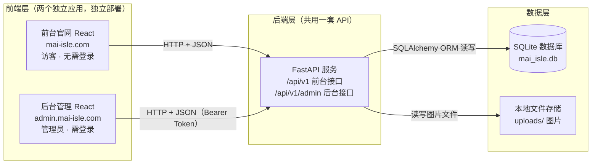
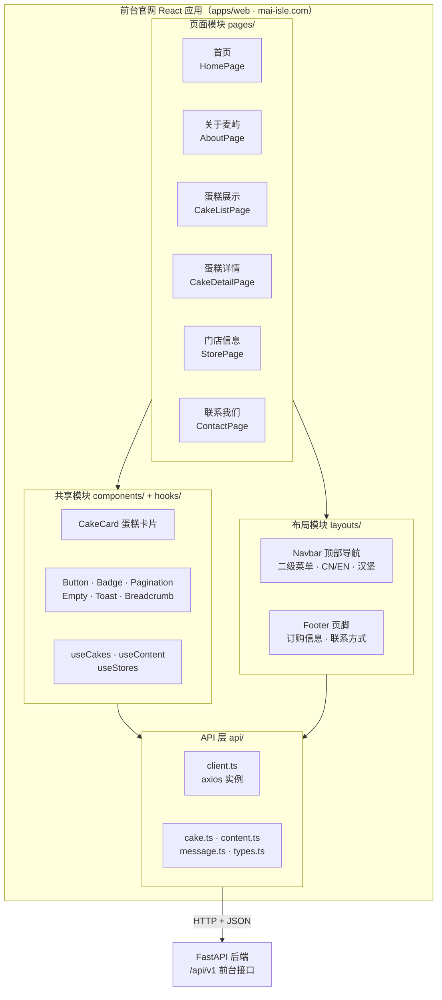
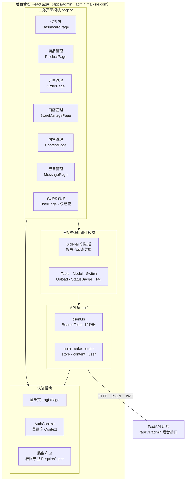
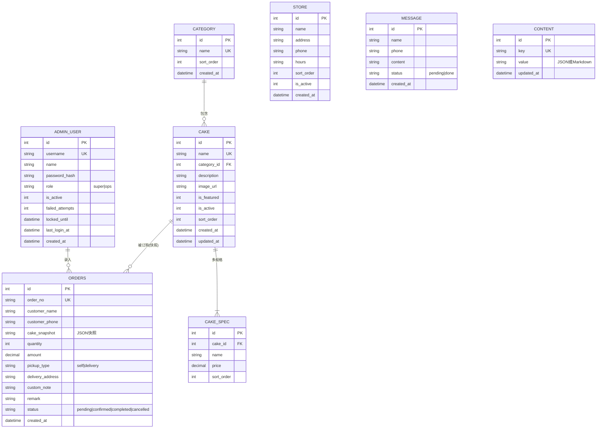
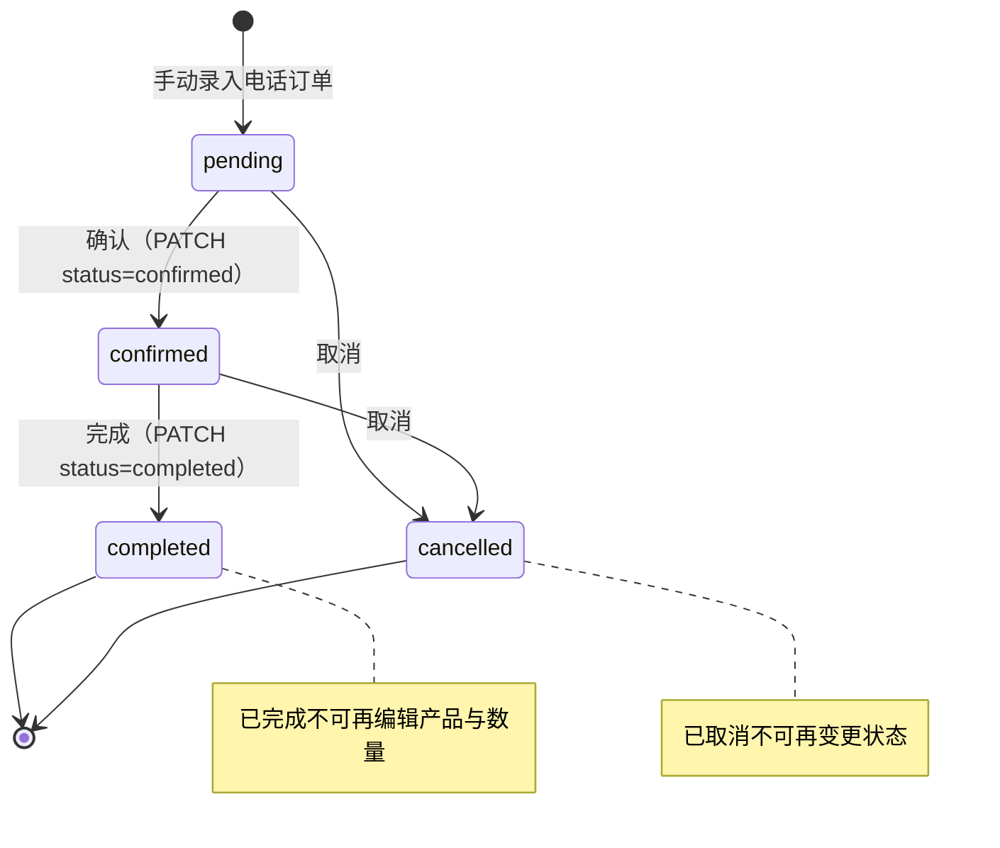

# 麦屿手作（Mai-Isle）技术开发文档

## 0. 文档信息

| 项目 | 内容 |
|------|------|
| 品牌名称 | 麦屿手作 Mai-Isle |
| 文档名称 | 前后端技术开发文档 |
| 版本 | v1.1 |
| 创建日期 | 2026-08-27 |
| 文档状态 | 待评审 |
| 技术栈 | 前端 React 18 + TypeScript / 后端 FastAPI / 数据库 SQLite |
| 关联文档 | 蛋糕店官网PRD.md（v2.3）、麦屿手作UI-UX设计文档.md（v1.2）、API接口契约文档.md（v1.0） |

### 0.1 文档定位

本文档是《麦屿手作》项目的**实现层施工蓝图**：将 PRD（做什么）、UI/UX 设计文档（长什么样）、API 接口契约（接口怎么定）三份文档翻译为开发团队可直接照做的代码级方案，覆盖：

- 前后端开发流程（第 3、6、7、10 章）
- 详细接口设计（第 5 章）
- 数据库设计（第 4 章）
- 测试、部署与已知问题规避（第 8、9、11 章）

### 0.2 版本记录

| 版本 | 日期 | 变更内容 |
|------|------|----------|
| v1.0 | 2026-08-27 | 初始版本，基于 PRD v2.3、UI/UX 文档 v1.2、API 契约 v1.0 撰写 |
| v1.1 | 2026-08-27 | **架构师评审修订**：① 修正 3 处文档内部引用错误（0.3 差异裁定、1.3 快照、4.5 状态机）；② database.py 补 `PRAGMA foreign_keys=ON`（SQLite 外键默认关闭，否则 CASCADE/外键校验静默失效）；③ 部署改单 worker（SQLite 并发写锁 + 验证码内存缓存跨进程失效），7.7 交叉引用同步；④ 分类删除 `move_to_id` 由请求体改为 **Query 参数**（DELETE body 兼容性风险）；⑤ 上传文件名改 uuid 片段防同秒覆盖；⑥ 订单金额计算明确用 Decimal 防浮点误差；⑦ 精选蛋糕 `featured=1` 参数定稿（5.2.1/5.2.8）；⑧ requirements 固定 bcrypt 4.0.x 消除 passlib 版本告警；⑨ 补充表结构变更管理说明；⑩ 明确 JWT 滑动过期由前端实现、后端 exp 为固定 30 分钟 |

### 0.3 与本项目其他文档的关系

```
蛋糕店官网PRD.md v2.3        → 需求来源（功能编号 F1–F15）
麦屿手作UI-UX设计文档.md v1.2 → 设计基准（Token / 组件 / 交互规范）
API接口契约文档.md v1.0       → 接口约定层（本文档第 5 章为其实现层细化）
麦屿手作技术开发文档.md v1.0  ← 本文档（实现层，可直接指导编码）
```

**差异裁定原则**：当各文档出现冲突时，优先级为 **PRD v2.3 = UI/UX 文档 v1.2 > API 契约 v1.0 > 原型**。已知差异已在对应章节标注（如 Hero 轮播数量，见 4.3 节 content 表、5.2.5 与 5.2.8）。

---

## 1. 项目概述与技术架构

### 1.1 项目背景

麦屿手作（Mai-Isle）是一家以"手作温度 × 轻奢质感"为品牌理念的蛋糕店。本项目为其建设**品牌展示型官网（前台）**与**后台管理系统（后台）**：

- **前台**：纯品牌展示，不提供在线下单与支付；客户通过页面展示的订购专线电话下单，可提交留言咨询。
- **后台**：运营人员自助维护商品、门店、页面内容；手动录入并跟踪电话订单；查看并处理前台留言。

### 1.2 系统架构图

前台官网与后台管理为**两个独立部署的 React 应用**，共用同一套 FastAPI 后端 API，后端读写 SQLite 数据库：



#### 1.2.1 前台系统架构图（模块图）

前台官网由「页面 / 布局 / 共享 / API」四类模块组成，页面与布局模块均依赖共享组件与 hooks，所有数据请求统一经 `api/` 层访问后端 `/api/v1` 前台接口（模块划分对应第 3 章目录结构与第 6.3 节路由表）：



> 上图由 Mermaid 渲染生成；以下为可编辑源码（源文件 `images/front-arch.mmd`）：



#### 1.2.2 后台系统架构图（模块图）

后台管理由「认证 / 业务页面 / 框架 / API」四类模块组成：`AuthContext` 与路由守卫保护所有页面，业务页面复用框架组件（侧边栏按角色渲染菜单），全部请求经带 Bearer Token 的 API 层访问 `/api/v1/admin` 后台接口；token 失效（40100）时由拦截器统一跳转登录页（对应第 6.7 节）：


> 上图由 Mermaid 渲染生成；以下为可编辑源码（源文件 `images/admin-arch.mmd`）：



**架构要点**：

| # | 要点 | 说明 |
|---|------|------|
| 1 | 前后台独立部署 | 前台 `mai-isle.com`，后台 `admin.mai-isle.com`；前台不提供后台登录入口（PRD §9.1） |
| 2 | 共用一套后端 | 区分访客/管理端靠**路径前缀**（`/api/v1` 与 `/api/v1/admin`）+ **JWT 认证** |
| 3 | 前端不碰数据库 | 所有数据读写经后端 API，前端只负责展示与交互 |
| 4 | 数据层轻量 | SQLite 单文件数据库 + 本地 uploads 目录存图片，满足小规模运营场景 |
| 5 | 图片存储 | 统一 `POST /api/v1/admin/upload` 上传，返回 URL，商品/内容/门店复用 |

### 1.3 核心设计决策（对应 PRD 验收项）

| 决策 | 依据 | 落地位置 |
|------|------|----------|
| 商品不支持删除，仅下架 | PRD §6.3.3 边界与异常 | 后端不提供 DELETE 接口；前端操作列仅有"上架/下架"，下架按钮 hover 提示"产品不支持删除" |
| 订单保存规格与价格快照 | PRD §6.3.4 | `orders.cake_snapshot` JSON 字段（见 4.3 节表 5 与 5.3.5） |
| 订单金额自动计算，不可手改 | PRD §6.3.4 | 后端计算 `amount = price × quantity`，请求体不接受 amount |
| 运营管理员隐藏"管理员管理"菜单 | PRD §6.3.9 | 前端按角色渲染菜单 + 后端依赖注入双重拦截（40300） |
| Hero 轮播 1–4 张 | PRD v2.3 / UI-UX v1.2（契约文档 1–3 作废） | `content.banners` 数组长度 1–4 校验 |
| 蛋糕展示排序本期实现 | UI-UX v1.2 §5.3 | 接口 `sort` 参数：recommend / price_asc / price_desc / newest |
| 富文本存 Markdown | 本方案确认 | `content.value` 存 Markdown 文本，前端 react-markdown 渲染 |

---

## 2. 技术栈与版本清单

### 2.1 技术栈总览

| 层 | 技术 | 选型理由 |
|----|------|----------|
| 前端框架 | React 18 + TypeScript | 用户指定；TS 提供类型提示，降低联调出错率 |
| 前端构建 | Vite 5 | 开发启动快、配置简单，适合两个独立应用 |
| 路由 | React Router v6 | 前台 BrowserRouter / 后台 BrowserRouter（登录态守卫） |
| HTTP 客户端 | Axios | 拦截器统一处理 token、错误码、401 跳转 |
| 状态管理 | React Context + useReducer | 本方案确认：后台登录态用 Context，不引入 Redux/Zustand |
| 样式方案 | CSS Modules + 全局 CSS Variables | 对齐 UI/UX 文档 Design Token（第 6.4 节） |
| 富文本渲染 | react-markdown | 本方案确认：内容管理存 Markdown |
| 后端框架 | FastAPI | 用户指定；自带 Swagger 文档（/docs）便于联调 |
| ORM | SQLAlchemy 2.x | 本方案确认；同步引擎 + SQLite |
| 数据校验 | Pydantic v2 | FastAPI 内置，请求/响应模型双保险 |
| 认证 | JWT（python-jose）+ passlib | 无状态会话，30 分钟无操作失效（PRD F8-2） |
| 图形验证码 | Pillow | 生成图片验证码 + captcha_id 会话校验 |
| 文件上传 | python-multipart | 本地 uploads 目录存储 |
| 数据库 | SQLite 3 | PRD §9.1 指定轻量方案 |

### 2.2 依赖版本清单（requirements.txt）

```
fastapi==0.115.*
uvicorn[standard]==0.30.*
sqlalchemy==2.0.*
pydantic==2.*
pydantic-settings==2.*
python-jose[cryptography]==3.3.*
passlib[bcrypt]==1.7.*
bcrypt==4.0.*    # 固定 4.0.x：passlib 1.7.4 搭配 bcrypt>=4.1 会报 __about__ 读取告警（功能可用但噪音大）
pillow==10.*
python-multipart==0.0.*
```

### 2.3 前端依赖清单（package.json 关键项）

```json
{
  "dependencies": {
    "react": "^18.3.1",
    "react-dom": "^18.3.1",
    "react-router-dom": "^6.26.0",
    "axios": "^1.7.0",
    "react-markdown": "^9.0.0"
  },
  "devDependencies": {
    "typescript": "^5.5.0",
    "vite": "^5.4.0",
    "@vitejs/plugin-react": "^4.3.0",
    "vitest": "^2.0.0",
    "@testing-library/react": "^16.0.0"
  }
}
```

### 2.4 环境要求

| 项 | 要求 |
|----|------|
| Node.js | ≥ 18.18 |
| Python | ≥ 3.10 |
| 操作系统 | Windows / macOS / Linux 均可 |

---

## 3. 项目目录结构

采用 monorepo 单仓库管理：`apps/web`（前台）、`apps/admin`（后台）、`server`（后端），共用一份文档与种子数据脚本。

```
蛋糕店官网_20260826/
├── apps/                                  # 前端（两个独立应用）
│   ├── web/                               # 前台官网（mai-isle.com）
│   │   ├── index.html
│   │   ├── vite.config.ts                 # 代理 /api → localhost:8000
│   │   ├── tsconfig.json
│   │   ├── package.json
│   │   └── src/
│   │       ├── main.tsx                   # 入口，挂载 Router
│   │       ├── App.tsx                    # 路由表（见 6.3 节）
│   │       ├── api/                       # API 层封装（见 6.4 节）
│   │       │   ├── client.ts              #   axios 实例 + 拦截器
│   │       │   ├── cake.ts
│   │       │   ├── content.ts
│   │       │   ├── message.ts
│   │       │   └── types.ts               #   接口 TS 类型定义
│   │       ├── components/                # 通用组件（见 6.5 节）
│   │       │   ├── Button/
│   │       │   ├── Badge/
│   │       │   ├── Pagination/
│   │       │   ├── Empty/
│   │       │   ├── Toast/
│   │       │   ├── CakeCard/
│   │       │   └── ...
│   │       ├── layouts/                   # 全局框架
│   │       │   ├── Navbar.tsx             #   主导航 + 二级菜单 + 语言切换 + 汉堡
│   │       │   └── Footer.tsx             #   页脚（数据来自 content）
│   │       ├── pages/                     # 页面（见 6.6 节）
│   │       │   ├── HomePage/
│   │       │   ├── AboutPage/
│   │       │   ├── CakeListPage/
│   │       │   ├── CakeDetailPage/
│   │       │   ├── StorePage/
│   │       │   └── ContactPage/
│   │       ├── hooks/                     # 自定义 hooks（useCakes、useContent 等）
│   │       ├── styles/
│   │       │   ├── tokens.css             # Design Token 全局变量（见 6.4 节）
│   │       │   └── global.css
│   │       └── utils/
│   └── admin/                             # 后台管理（admin.mai-isle.com）
│       ├── index.html
│       ├── vite.config.ts
│       └── src/
│           ├── main.tsx
│           ├── App.tsx                    # 路由表 + 登录守卫（见 6.3 节）
│           ├── api/                       # client.ts / cake.ts / order.ts / ...
│           ├── context/
│           │   └── AuthContext.tsx        # 登录态 Context（见 6.7 节）
│           ├── components/
│           │   ├── Layout/                #   侧边栏 + 主区框架
│           │   │   ├── Sidebar.tsx        #     菜单按角色渲染
│           │   │   └── PageHeader.tsx
│           │   ├── Table/
│           │   ├── Modal/
│           │   ├── Switch/
│           │   ├── Upload/
│           │   ├── SearchInput/
│           │   └── ...
│           ├── pages/
│           │   ├── LoginPage/
│           │   ├── DashboardPage/
│           │   ├── ProductPage/           #   列表 + 分类管理 + 新增/编辑弹窗
│           │   ├── OrderPage/
│           │   ├── StorePage/
│           │   ├── ContentPage/
│           │   ├── MessagePage/
│           │   └── UserPage/              #   仅超管可见
│           └── utils/
├── server/                                # 后端 FastAPI
│   ├── requirements.txt
│   ├── run.py                             # 启动入口：uvicorn
│   ├── app/
│   │   ├── __init__.py
│   │   ├── main.py                        # FastAPI 实例、CORS、路由注册（见 7.2 节）
│   │   ├── config.py                      # 配置（JWT 密钥、上传目录、Token 有效期）
│   │   ├── database.py                    # engine / SessionLocal / Base
│   │   ├── models.py                      # 8 张表 ORM 模型（见 4.2 节）
│   │   ├── schemas.py                     # Pydantic 请求/响应模型
│   │   ├── security.py                    # 密码哈希、JWT 生成/校验、登录锁定
│   │   ├── deps.py                        # get_db / get_current_user / require_super
│   │   ├── routers/
│   │   │   ├── __init__.py
│   │   │   ├── front.py                   # 前台接口（/api/v1/...）
│   │   │   ├── auth.py                    # 登录/登出/me
│   │   │   ├── dashboard.py               # 仪表盘统计
│   │   │   ├── cakes.py                   # 商品 + 分类
│   │   │   ├── orders.py                  # 订单
│   │   │   ├── stores.py                  # 门店
│   │   │   ├── content.py                 # 内容管理
│   │   │   ├── messages.py                # 留言
│   │   │   ├── users.py                   # 管理员
│   │   │   ├── upload.py                  # 图片上传
│   │   │   └── captcha.py                 # 图形验证码
│   │   └── utils/
│   │       ├── captcha_gen.py             # Pillow 验证码生成
│   │       ├── order_no.py                # 订单号生成（YYYYMMDD+序号）
│   │       └── response.py                # 统一响应封装（code/message/data）
│   ├── uploads/                           # 图片存储目录（运行时生成）
│   │   ├── cakes/
│   │   ├── banners/
│   │   └── stores/
│   ├── seed.py                            # 种子数据脚本（见 4.3 节）
│   └── tests/                             # pytest 测试（见 8 章）
│       ├── conftest.py
│       ├── test_front_api.py
│       ├── test_admin_auth.py
│       ├── test_admin_cakes.py
│       └── test_admin_orders.py
├── docs/                                  # 文档归档
│   ├── 蛋糕店官网PRD.md
│   ├── 麦屿手作UI-UX设计文档.md
│   └── API接口契约文档.md
├── database/                              # SQLite 文件目录（运行时生成）
│   └── mai_isle.db
└── README.md                              # 开发环境启动说明（见 3.1 节）
```

### 3.1 开发环境启动流程

```bash
# 1. 后端
cd server
python -m venv .venv
source .venv/bin/activate        # Windows: .venv\Scripts\activate
pip install -r requirements.txt
python seed.py                    # 初始化数据库 + 种子数据（可重复执行）
python run.py                     # 启动，访问 http://localhost:8000/docs

# 2. 前台（另开终端）
cd apps/web
npm install
npm run dev                       # 访问 http://localhost:5173

# 3. 后台（另开终端）
cd apps/admin
npm install
npm run dev                       # 访问 http://localhost:5174
```

**前端代理配置**（vite.config.ts）：开发时前端请求 `/api` 自动转发到后端，避免跨域问题：

```typescript
// apps/web/vite.config.ts 与 apps/admin/vite.config.ts 相同配置
export default defineConfig({
  plugins: [react()],
  server: {
    port: 5173, // admin 用 5174
    proxy: {
      '/api': { target: 'http://localhost:8000', changeOrigin: true }
    }
  }
});
```

### 3.2 前后端并行开发约定

- **接口先行**：前后端严格按第 5 章接口定义开发，前端可用 `apps/web/src/api/mock/` 下 mock 数据先行渲染界面（联调前替换为真实请求，mock 数据文件不入库）。
- **契约变更流程**：任何接口变更必须先更新 API接口契约文档.md 与本文档第 5 章，再通知两端，禁止单方擅自改参数。
- **命名规范**：接口路径一律小写复数名词；请求/响应字段统一 snake_case；时间统一 ISO 8601 字符串（如 `2026-08-27T10:00:00`）。

---

## 4. 数据库设计

### 4.1 设计原则

- **8 张表**覆盖全部业务：管理员、分类、蛋糕、蛋糕规格、订单、门店、留言、内容。
- **规格独立成表**（cake_spec）：多规格价格是前台详情页、订单金额计算的依据，独立表便于维护与查询。
- **订单保存快照**（cake_snapshot JSON）：记录下单时产品名/规格名/单价，后续改产品配置不影响历史订单（PRD §6.3.4）。
- **内容表 key-value 结构**：content 表以 `key` 区分 9 类运营内容，`value` 存 JSON 或 Markdown，前台按 key 读取。
- **登录锁定持久化**：admin_user 表内置 `failed_attempts` 与 `locked_until`，连续 5 次错误锁定 15 分钟（PRD §6.3.1）。

### 4.2 E-R 图



> 上图由 Mermaid 渲染生成；以下为可编辑源码（源文件 `images/er.mmd`），修改后可用 mermaid-cli 重新生成：



### 4.3 完整建表 SQL（SQLite）

以下 DDL 可直接在 SQLite 执行；ORM 模型（models.py）字段与之一一对应，以 DDL 为最终准绳。

```sql
-- ============================================
-- 麦屿手作 Mai-Isle 数据库建表脚本
-- 数据库文件：database/mai_isle.db
-- 执行方式：python seed.py（内部自动执行本脚本）
-- ============================================

-- 1. 管理员表
CREATE TABLE admin_user (
    id              INTEGER PRIMARY KEY AUTOINCREMENT,
    username        TEXT    NOT NULL UNIQUE,             -- 登录账号，唯一
    name            TEXT    NOT NULL,                    -- 姓名
    password_hash   TEXT    NOT NULL,                    -- 密码哈希（bcrypt）
    role            TEXT    NOT NULL DEFAULT 'ops'
                    CHECK (role IN ('super', 'ops')),    -- super=超级管理员 / ops=运营管理员
    is_active       INTEGER NOT NULL DEFAULT 1,          -- 1=启用 0=停用
    failed_attempts INTEGER NOT NULL DEFAULT 0,          -- 连续密码错误次数
    locked_until    DATETIME,                            -- 锁定截止时间（NULL=未锁定）
    last_login_at   DATETIME,                            -- 最后登录时间
    created_at      DATETIME NOT NULL,
    updated_at      DATETIME NOT NULL
);

-- 2. 分类表
CREATE TABLE category (
    id          INTEGER PRIMARY KEY AUTOINCREMENT,
    name        TEXT    NOT NULL UNIQUE,                 -- 分类名（2-30 字）
    sort_order  INTEGER NOT NULL DEFAULT 0,              -- 排序，越小越靠前
    created_at  DATETIME NOT NULL
);

-- 3. 蛋糕表
CREATE TABLE cake (
    id           INTEGER PRIMARY KEY AUTOINCREMENT,
    name         TEXT    NOT NULL UNIQUE,                -- 产品名（2-50 字，唯一）
    category_id  INTEGER NOT NULL REFERENCES category(id),
    description  TEXT,                                   -- 描述（≤2000 字）
    image_url    TEXT    NOT NULL,                       -- 产品图 URL
    is_featured  INTEGER NOT NULL DEFAULT 0,             -- 1=首页推荐
    is_active    INTEGER NOT NULL DEFAULT 1,             -- 1=上架 0=下架
    sort_order   INTEGER NOT NULL DEFAULT 0,
    created_at   DATETIME NOT NULL,
    updated_at   DATETIME NOT NULL
);
CREATE INDEX idx_cake_category ON cake(category_id);
CREATE INDEX idx_cake_active_sort ON cake(is_active, sort_order);

-- 4. 蛋糕规格表（多规格价格）
CREATE TABLE cake_spec (
    id         INTEGER PRIMARY KEY AUTOINCREMENT,
    cake_id    INTEGER NOT NULL REFERENCES cake(id) ON DELETE CASCADE,
    name       TEXT    NOT NULL,                         -- 规格名（≤20 字，如"6 寸"）
    price      NUMERIC(10,2) NOT NULL CHECK (price > 0), -- 价格（>0，两位小数）
    sort_order INTEGER NOT NULL DEFAULT 0
);
CREATE INDEX idx_spec_cake ON cake_spec(cake_id);

-- 5. 订单表（电话订单，后台手动录入）
CREATE TABLE orders (
    id               INTEGER PRIMARY KEY AUTOINCREMENT,
    order_no         TEXT    NOT NULL UNIQUE,            -- 订单号 YYYYMMDD+序号
    customer_name    TEXT    NOT NULL,                   -- 客户姓名（2-20 字）
    customer_phone   TEXT    NOT NULL,                   -- 联系电话（11 位手机号）
    cake_snapshot    TEXT    NOT NULL,                   -- JSON 快照 {cake_id,cake_name,spec_name,price}
    quantity         INTEGER NOT NULL CHECK (quantity >= 1),
    amount           NUMERIC(10,2) NOT NULL,             -- 自动计算 = 快照价格 × 数量
    pickup_type      TEXT    NOT NULL
                     CHECK (pickup_type IN ('self', 'delivery')),  -- self=到店自提 delivery=配送
    delivery_address TEXT,                               -- 配送地址（配送时必填，≤200 字）
    custom_note      TEXT,                               -- 定制需求（≤500 字）
    remark           TEXT,                               -- 备注（≤500 字）
    status           TEXT    NOT NULL DEFAULT 'pending'
                     CHECK (status IN ('pending','confirmed','completed','cancelled')),
    created_at       DATETIME NOT NULL,
    updated_at       DATETIME NOT NULL
);
CREATE INDEX idx_orders_status ON orders(status);
CREATE INDEX idx_orders_created ON orders(created_at DESC);

-- 6. 门店表
CREATE TABLE store (
    id         INTEGER PRIMARY KEY AUTOINCREMENT,
    name       TEXT    NOT NULL,                         -- 门店名（2-30 字）
    address    TEXT    NOT NULL,                         -- 地址（≤100 字）
    phone      TEXT    NOT NULL,                         -- 电话（≤20 字）
    hours      TEXT,                                     -- 营业时间（≤50 字，如"08:00-21:00"）
    image_url  TEXT,                                     -- 门店图 URL（可选，≤5MB，jpg/png/webp）
    sort_order INTEGER NOT NULL DEFAULT 0,
    is_active  INTEGER NOT NULL DEFAULT 1,               -- 1=启用 0=停用
    created_at DATETIME NOT NULL,
    updated_at DATETIME NOT NULL
);

-- 7. 留言表（前台联系我们表单产生）
CREATE TABLE message (
    id         INTEGER PRIMARY KEY AUTOINCREMENT,
    name       TEXT    NOT NULL,                         -- 姓名（2-20 字）
    phone      TEXT    NOT NULL,                         -- 电话（11 位手机号）
    content    TEXT    NOT NULL,                         -- 留言内容（1-500 字）
    status     TEXT    NOT NULL DEFAULT 'pending'
               CHECK (status IN ('pending', 'done')),    -- pending=未处理 done=已处理
    created_at DATETIME NOT NULL
);
CREATE INDEX idx_message_status ON message(status);

-- 8. 内容表（key-value，前台内容区块）
CREATE TABLE content (
    id         INTEGER PRIMARY KEY AUTOINCREMENT,
    key        TEXT    NOT NULL UNIQUE,                  -- 内容键（见下表）
    value      TEXT    NOT NULL,                         -- JSON 或 Markdown 文本
    updated_at DATETIME NOT NULL
);
```

> **表结构变更管理**：本项目未引入 Alembic 迁移工具。改表结构时须同步更新 4.3 DDL、models.py 与本文档，并在开发环境通过 `Base.metadata.create_all` 重建或手工 ALTER；**上线后改动需先备份 database/mai_isle.db 与 uploads/**。

**content.key 取值一览**：

| key | 存储格式 | 对应前台区块（UI-UX 文档 5.1/5.2） |
|-----|----------|-----------------------------------|
| `banners` | JSON 数组（1–4 张） | 首页 Hero 轮播 |
| `brand_story` | Markdown | 首页品牌故事 teaser + 关于麦屿品牌故事 |
| `brand_value` | Markdown | 关于麦屿品牌理念 |
| `brand_chars` | JSON 数组 | 品牌特色卡片（3 条：甄选食材/手作工艺/服务初心） |
| `brand_journey` | JSON 数组 | 品牌历程时间线 |
| `hardware` | JSON 数组 | 硬件保障列表 |
| `software` | JSON 数组 | 软件实力列表 |
| `order_info` | JSON 对象 | 订购专线/服务时间/配送说明（页脚+首页订购区共用） |
| `contact_info` | JSON 对象 | 联系我们页地址/邮箱 |
| `custom_tips` | Markdown | 蛋糕详情页定制说明 |

### 4.4 种子数据（seed.py）

初始化脚本 `server/seed.py` 幂等执行（已存在的数据跳过），包含：

**① 8 个初始分类**（PRD §6.2.3 F2-1）

| sort_order | 分类名 |
|-----------|--------|
| 1 | 红丝绒系列 |
| 2 | 慕斯系列 |
| 3 | 芝士系列 |
| 4 | 抹茶系列 |
| 5 | 巧克力系列 |
| 6 | 水果系列 |
| 7 | 翻糖系列 |
| 8 | 节日限定 |

**② 默认超级管理员**

| 字段 | 值 | 说明 |
|------|-----|------|
| username | `admin` | 首登后建议在"管理员管理"中修改 |
| password | `admin123` | 初始密码，生产环境部署后必须修改 |
| role | `super` | 系统至少保留 1 个超管（PRD §6.3.8） |

```python
# seed.py 核心片段（示意）
from passlib.context import CryptContext
pwd = CryptContext(schemes=["bcrypt"], deprecated="auto")
admin = AdminUser(
    username="admin", name="系统管理员",
    password_hash=pwd.hash("admin123"),
    role="super", is_active=1,
)
```

**③ 内容初始化**（文案见 PRD §6.2.5.1）

- `brand_story`：品牌故事 3 段文案（"城市的节奏总是匆匆……2020 年，麦屿手作正式诞生……"）
- `brand_journey`：5 条时间线（2020 诞生 / 2021 中央手作工坊 / 2022 甄选食材体系 / 2024 门店 8 家 / 2026 数字化运营）
- `order_info`：`{"hotline": "021-XXXXXXX", "hours": "08:00-18:00", "delivery_note": "11 点前订购当日送达 · 市内免费配送"}`
- `contact_info`：`{"address": "上海市浦东新区迎春路 767 号", "email": "hello@mai-isle.com"}`
- `custom_tips`：`支持尺寸/口味/图案/祝福语定制，建议提前 1 天电话预约`
- `banners`：空数组 `[]`（上线前由运营在后台补充图片）
- 其余 keys：空数组 `[]` 或空串

**注意**：`banners` 初始为空数组时，前台首页 Hero 区块整体隐藏（PRD §6.2.2 规则：区块内容为空则隐藏），符合验收要求。

### 4.5 订单状态机

订单状态流转约束在**后端 PATCH 接口强制校验**（见 5.3.5），前端按状态渲染可操作按钮：



**合法流转表**（后端校验依据）：

| 当前状态 | 允许流转到 | 禁止 |
|----------|-----------|------|
| pending（待处理） | confirmed / cancelled | completed |
| confirmed（已确认） | completed / cancelled | pending |
| completed（已完成） | 无 | 任何流转 |
| cancelled（已取消） | 无 | 任何流转 |

---

## 5. 详细接口设计

> 本章是 API接口契约文档.md 的**实现层细化**：契约文档只约定"传什么、出什么"，本章补充 HTTP 状态码、请求/响应完整示例、字段校验规则、数据库影响与错误码。**前后端开发以本章为准，契约文档仅作参考**。

### 5.1 通用约定

#### 5.1.1 Base URL

| 环境 | Base URL | 说明 |
|------|----------|------|
| 本地开发 | `http://localhost:8000/api/v1` | 前端经 Vite proxy 转发 `/api` |
| 生产（建议） | `https://api.mai-isle.com/api/v1` | 与 PRD §9.1 一致 |

前台接口路径前缀 `/api/v1`（无需登录）；后台接口前缀 `/api/v1/admin`（需登录）。

#### 5.1.2 认证方式（后台接口）

- 登录成功返回 `access_token`（JWT，HS256），有效期 **30 分钟无操作自动失效**（PRD F8-2；实现时 JWT 携带 `exp`，前端每次请求刷新滑动过期时间——前端在请求拦截器记录最后活跃时间，超过 30 分钟主动登出）。
- 请求头：`Authorization: Bearer <access_token>`。
- Token 无效/过期：HTTP 401 + `code: 40100`，前端跳转后台登录页。

#### 5.1.3 统一响应格式

所有接口返回统一包裹（HTTP 状态码与业务 code 配合使用）：

```json
{ "code": 0, "message": "success", "data": { } }
```

**HTTP 状态码与 code 映射规则**：

| HTTP 状态码 | 业务 code | 场景 |
|:-----------:|:---------:|------|
| 200 | 0 | 成功 |
| 400 | 40001 | 参数校验失败 |
| 400 | 40002 | 验证码错误 |
| 401 | 40100 | 未登录或 Token 过期 |
| 401 | 40101 / 40102 / 40103 | 账号密码错误 / 已停用 / 已锁定 |
| 403 | 40300 | 权限不足 |
| 404 | 40400 | 资源不存在 |
| 409 | 40900 | 数据冲突（如产品重名） |
| 500 | 50000 | 服务器内部错误 |

前端统一在 Axios 响应拦截器按 `code` 分发处理（见 6.4.2）。

#### 5.1.4 错误码表（完整）

| code | 含义 | 前端处理 |
|------|------|----------|
| 0 | 成功 | 正常流程 |
| 40001 | 参数校验失败 | 字段下方提示 `message`（前台表单）；后台 Toast 提示 |
| 40002 | 验证码错误 | 提示"验证码错误，请重新输入"，刷新验证码 |
| 40100 | 未登录或 Token 过期 | 跳转后台登录页 |
| 40101 | 账号或密码错误 | 登录页提示 `message` |
| 40102 | 账号已停用 | 登录页提示"账号已停用" |
| 40103 | 账号已锁定 | 登录页提示"请 15 分钟后再试" |
| 40300 | 权限不足 | 后台提示无权限（运营管理员访问用户管理） |
| 40400 | 资源不存在 | 前台详情 404 / 后台提示"记录不存在" |
| 40900 | 数据冲突（产品/分类重名） | 提示"名称已存在" |
| 50000 | 服务器内部错误 | 提示"操作失败，请稍后重试" |

#### 5.1.5 分页约定

```json
{ "code": 0, "message": "success", "data": {
  "items": [], "total": 28, "page": 1, "page_size": 12, "total_pages": 3
} }
```

请求参数：`page`（默认 1）、`page_size`（默认 12，前台蛋糕列表固定 12）。`total_pages = ceil(total / page_size)`。

#### 5.1.6 手机号脱敏规范

后台列表接口返回的 `customer_phone` 一律脱敏为 `138****6321` 格式（中间 4 位掩码）；详情接口返回完整手机号（仅限有权限的后台用户）。

---

### 5.2 前台接口（无需登录）

#### 5.2.1 蛋糕列表 `GET /api/v1/cakes`

**功能**：蛋糕展示页产品网格（PRD F2）。支持分类筛选、分页、四种排序（UI-UX v1.2 确认本期实现）。

**Query 参数**：

| 参数 | 类型 | 必填 | 默认 | 说明 |
|------|------|:----:|------|------|
| category_id | int | 否 | 无 | 不传=全部；传=仅该分类上架产品 |
| featured | int | 否 | 无 | 1=仅返回"首页推荐"产品（首页精选蛋糕区块用，见 5.2.8；与 category_id 可叠加） |
| page | int | 否 | 1 | 页码 |
| page_size | int | 否 | 12 | 每页条数（固定 12） |
| sort | string | 否 | recommend | `recommend` 推荐 / `price_asc` 价格低到高 / `price_desc` 价格高到低 / `newest` 新品优先 |

**排序规则**：

| sort 值 | 排序逻辑 |
|---------|----------|
| recommend | `sort_order` 升序 → `created_at` 倒序（默认） |
| price_asc | 按最低规格价 `price_from` 升序 |
| price_desc | 按最低规格价降序 |
| newest | 按 `created_at` 倒序 |

**响应 data**：

```json
{
  "items": [
    {
      "id": 1,
      "name": "醇香红丝绒",
      "category": "红丝绒系列",
      "image_url": "/uploads/cakes/red_velvet.jpg",
      "price_from": 168.00,
      "is_featured": true
    }
  ],
  "total": 28, "page": 1, "page_size": 12, "total_pages": 3
}
```

**实现要点**：
- 仅返回 `is_active = true` 产品；`price_from` 为 `MIN(cake_spec.price)`（按 sort_order 取最小，价格相同取第一个）；`category` 返回分类名称。
- 排序在 **SQL 层完成**（联表子查询价格），禁止取出全量后在内存排序。
- 空分类返回 `items: []`，前端展示空状态（UI-UX §4.10）。
- 错误码：无业务错误；SQL 异常返回 50000。

#### 5.2.2 蛋糕详情 `GET /api/v1/cakes/{id}`

**功能**：蛋糕详情页（PRD F3）。

**响应 data**：

```json
{
  "id": 1,
  "name": "醇香红丝绒",
  "category": "红丝绒系列",
  "description": "比利时可可与马达加斯加香草的曼妙碰撞……",
  "image_url": "/uploads/cakes/red_velvet.jpg",
  "specs": [
    { "name": "6 寸", "price": 168.00 },
    { "name": "8 寸", "price": 228.00 },
    { "name": "10 寸", "price": 288.00 }
  ],
  "related": [
    { "id": 4, "name": "经典芝士蛋糕", "price_from": 178.00, "image_url": "/uploads/cakes/cheese.jpg" }
  ],
  "custom_tips": "支持尺寸/口味/图案/祝福语定制，建议提前 1 天电话预约"
}
```

**实现要点**：
- `specs` 按 sort_order 升序返回完整规格（≥1 个）。
- `related`：同分类其他**上架**产品，排除当前产品，最多 4 个。
- `custom_tips`：来自 `content.key='custom_tips'`，空则返回 `""`（前端隐藏定制区块）。
- 产品不存在或已下架：HTTP 404 + `code: 40400`（PRD F3 规则：下架后详情不可访问）。

#### 5.2.3 分类列表 `GET /api/v1/categories`

**功能**：蛋糕展示页左侧分类导航（PRD F2-1），含各分类上架产品数角标。

**响应 data**：

```json
{
  "items": [
    { "id": 1, "name": "红丝绒系列", "count": 4 },
    { "id": 2, "name": "慕斯系列", "count": 5 }
  ]
}
```

**实现要点**：`count` = 该分类下**上架**产品数；按 `sort_order` 升序；无产品分类也返回（count=0），前端照常展示。

#### 5.2.4 门店列表 `GET /api/v1/stores`

**功能**：门店信息页（PRD F5）。

**响应 data**：

```json
{
  "items": [
    { "id": 1, "name": "联洋店", "address": "上海市浦东新区迎春路 767 号", "phone": "021-58388761", "hours": "08:00-21:00", "image_url": "/uploads/stores/store1.jpg" }
  ]
}
```

**实现要点**：仅返回 `is_active = true`；按 `sort_order` 升序。前台首页"门店概览"取本接口前 3 条（PRD F1-3）。`image_url` 允许为空（门店无图时前台门店卡不展示图片）。

#### 5.2.5 内容区块 `GET /api/v1/content/{key}`

**功能**：读取前台各内容区块（PRD F13 前台呈现）。

**路径参数 key**：`banners` / `brand_story` / `brand_value` / `brand_chars` / `brand_journey` / `hardware` / `software` / `order_info` / `contact_info` / `custom_tips`。

**响应 data（以 banners 为例）**：

```json
{
  "key": "banners",
  "value": {
    "banners": [
      { "id": 1, "image_url": "/uploads/banners/b1.jpg", "slogan": "麦屿手作，手作每一份甜蜜", "subtitle": "EST. 2020 SHANGHAI", "sort_order": 1, "is_active": true }
    ]
  }
}
```

**实现要点**：
- 后端按 key 解析 JSON（banners/brand_chars/brand_journey/hardware/software/order_info/contact_info）或原样返回 Markdown 文本（brand_story/brand_value/custom_tips）。
- 未知 key：HTTP 404 + `code: 40400`。
- 前台页面可并发请求多个 key（`Promise.all`），**不提供聚合接口**（保持接口职责单一，避免前后台耦合）。
- 区块 value 为空（`[]`/`""`）时，前端隐藏对应区块（PRD §6.2.2）。

#### 5.2.6 获取图形验证码 `GET /api/v1/captcha`

**功能**：联系我们留言表单的图形验证码（PRD §6.2.7 F6-2）。契约文档待确认项，本文档定稿。

**响应**：`Content-Type: image/png`，直接返回验证码图片；同时通过响应头携带会话标识：

```
HTTP/1.1 200 OK
Content-Type: image/png
X-Captcha-Id: 9f8a7b6c-xxxx-xxxx
Body: <PNG 图片二进制>
```

**实现要点**：
- 后端用 Pillow 生成 130×44 的 4 位验证码图片：Cormorant 风格斜体大写字母+数字（去掉易混淆字符 0/O/1/I），背景 `--cream`（#F0E1B9）、字色 `--brown-deep`（#6B5238），加 2–3 条干扰线（UI-UX §5.6 验证码框规范）。
- 服务端以 `X-Captcha-Id` 为键存储验证码明文（内存字典或带过期时间的缓存），**有效期 5 分钟**，校验成功后立即删除（一次性）。
- 验证码不区分大小写。
- 前端每次加载表单/校验失败（code 40002）时重新调用本接口并更新 `X-Captcha-Id`。

#### 5.2.7 提交留言 `POST /api/v1/messages`

**功能**：联系我们留言表单提交（PRD F6-2 / F14）。留言默认 `pending`（未处理），进入后台留言管理。

**请求头**：`Content-Type: application/json`。

**请求体**：

```json
{
  "name": "林小姐",
  "phone": "13863210086",
  "content": "想预订一款 8 寸生日蛋糕，希望 9 月 1 日送到浦东",
  "captcha": "M8A2",
  "captcha_id": "9f8a7b6c-xxxx-xxxx"
}
```

**字段校验（前后端一致）**：

| 字段 | 规则 | 失败 code / message |
|------|------|---------------------|
| name | 2–20 字 | 40001 / "姓名需为 2-20 个字符" |
| phone | 11 位手机号 `^1[3-9]\d{9}$` | 40001 / "请输入 11 位有效手机号" |
| content | 1–500 字 | 40001 / "留言内容不能为空，且不超过 500 字" |
| captcha | 4 位，与图形验证码一致（忽略大小写） | 40002 / "验证码错误，请重新输入" |
| captcha_id | 必须与获取验证码时一致，且 5 分钟内有效 | 40002 / "验证码已过期，请重新输入" |

**成功响应**：

```json
{ "code": 0, "message": "success", "data": { "id": 23 } }
```

**实现要点**：
- 校验顺序：先字段格式（40001），后验证码（40002）；验证码错误时**后端删除该 captcha_id**，前端必须刷新验证码。
- 校验失败返回 40001 时，`data` 携带 `{"errors": {"phone": "请输入 11 位有效手机号"}}` 便于前端字段级提示（可选，前端也可本地先行校验）。
- 成功后前端清空表单并提示"提交成功，我们会尽快与您联系"（UI-UX §5.6）。

#### 5.2.8 首页数据加载策略（前端约定，非接口）

前台首页 5 个区块数据来源：

| 区块 | 接口 | 空内容处理 |
|------|------|-----------|
| Hero 轮播 | `GET /api/v1/content/banners` | 隐藏 |
| 精选蛋糕 | `GET /api/v1/cakes?page_size=6&sort=recommend&featured=1`（后端 `featured=1` 只返回首页推荐产品，见 5.2.1） | 隐藏 |
| 品牌故事 teaser | `GET /api/v1/content/brand_story` | 隐藏 |
| 门店概览 | `GET /api/v1/stores`（取前 3 条） | 隐藏 |
| 订购信息 | `GET /api/v1/content/order_info` | 隐藏 |

> 说明：精选蛋糕用 `GET /api/v1/cakes?featured=1`（已定稿，见 5.2.1），后端只返回 `is_featured=true` 的上架产品，前端一次请求即可，无需拉全量再过滤。

---

### 5.3 后台接口（需登录，`Authorization: Bearer <token>`）

> 除登录外，所有后台接口依赖 `get_current_user`；涉及权限的接口依赖 `require_super`（见 7.5 节）。运营管理员访问超管接口 → HTTP 403 + `code: 40300`。

#### 5.3.1 认证：登录 / 登出 / 当前用户

**① 登录 `POST /api/v1/admin/login`**

```json
// 请求体
{ "username": "admin", "password": "admin123" }

// 成功响应
{ "code": 0, "message": "success", "data": {
  "access_token": "eyJhbGciOiJIUzI1NiIs...",
  "token_type": "bearer",
  "user": { "id": 1, "username": "admin", "name": "系统管理员", "role": "super" }
} }

// 失败响应
{ "code": 40101, "message": "账号或密码错误", "data": null }
{ "code": 40102, "message": "账号已停用", "data": null }
{ "code": 40103, "message": "账号已锁定，请 15 分钟后再试", "data": null }
```

**登录流程（后端）**：
1. 查询 username → 不存在或密码错：`failed_attempts + 1`；若 `failed_attempts >= 5` 设置 `locked_until = now + 15min`，返回 40103；否则返回 40101。
2. 账号停用（is_active=0）→ 40102。
3. `locked_until` 未过期 → 40103；过期则重置 `failed_attempts=0`。
4. 成功：重置失败次数、更新 `last_login_at`，签发 JWT（payload: `sub=user.id, role, exp=now+30min`）。

**前端**：保存 token 与 user 到 localStorage + Context（见 6.7 节）。

**② 登出 `POST /api/v1/admin/logout`**

- 前端清除本地 token 并跳转登录页即可；后端返回 `{ "code": 0 }`（JWT 无状态，服务端不维护黑名单，本期从简）。

**③ 当前用户 `GET /api/v1/admin/me`**

```json
{ "code": 0, "message": "success", "data": {
  "id": 1, "username": "admin", "name": "系统管理员", "role": "super"
} }
```

用途：应用刷新后恢复登录态（校验 token 有效性 + 获取角色渲染菜单）。

#### 5.3.2 仪表盘统计 `GET /api/v1/admin/dashboard/stats`

**响应 data**：

```json
{
  "cake_count": 28,
  "month_order_count": 136,
  "store_count": 5,
  "pending_message_count": 3,
  "recent_orders": [
    { "id": 1, "order_no": "20260826001", "customer_name": "张三",
      "cake_name": "醇香红丝绒", "amount": 228.00, "status": "pending" }
  ],
  "order_status_distribution": { "pending": 12, "confirmed": 38, "completed": 76, "cancelled": 10 }
}
```

**实现要点**（实时计算，无缓存，PRD F9）：
- `cake_count`：全部产品数（含下架）；`month_order_count`：本月创建订单数；`store_count`：启用门店数；`pending_message_count`：未处理留言数。
- `recent_orders`：最近 10 笔（created_at 倒序），`cake_name` 取快照中产品名。
- `order_status_distribution`：按状态分组计数。

#### 5.3.3 商品管理（PRD F10）

**① 商品列表 `GET /api/v1/admin/cakes`**

| Query 参数 | 类型 | 必填 | 说明 |
|-----------|------|:----:|------|
| keyword | string | 否 | 按名称模糊搜索 |
| category_id | int | 否 | 按分类筛选 |
| is_active | int | 否 | 0=下架 1=上架（不传=全部） |
| is_featured | int | 否 | 1=首页推荐 |
| page / page_size | int | 否 | 分页，默认 1/12 |

**响应 data**：

```json
{
  "items": [
    { "id": 1, "name": "醇香红丝绒", "category": "红丝绒系列", "category_id": 1,
      "image_url": "/uploads/cakes/red_velvet.jpg", "spec_count": 3, "price_from": 168.00,
      "sort_order": 1, "is_featured": true, "is_active": true }
  ],
  "total": 28, "page": 1, "page_size": 12, "total_pages": 3
}
```

> 列表含全部状态产品（区别于前台仅上架）；`spec_count` 为规格数；表格"起价"列用 `price_from`。

**② 新增商品 `POST /api/v1/admin/cakes`**

```json
// 请求体
{
  "name": "经典栗子蛋糕",
  "category_id": 9,
  "specs": [
    { "name": "6 寸", "price": 158.00 },
    { "name": "8 寸", "price": 198.00 }
  ],
  "description": "秋日限定款……",
  "image_url": "/uploads/cakes/chestnut.jpg",
  "is_featured": true,
  "is_active": true,
  "sort_order": 7
}

// 成功响应
{ "code": 0, "message": "success", "data": { "id": 12 } }

// 重名冲突
{ "code": 40900, "message": "产品名称已存在，请更换", "data": null }
```

**字段校验（后端 Pydantic + 数据库双重保证）**：

| 字段 | 规则 | 失败 message |
|------|------|--------------|
| name | 2–50 字，唯一（DB UNIQUE 兜底） | "产品名称已存在，请更换"（40900） |
| category_id | 必须存在 | "分类不存在"（40001） |
| specs | 至少 1 个；name ≤20 字；price > 0 且 ≤2 位小数 | "规格至少 1 个，价格需大于 0" |
| image_url | 非空 | "请上传产品图" |
| description | ≤2000 字 | "描述不超过 2000 字" |

**事务要求**：cake 与 specs 在**同一事务**内写入（任一失败整体回滚）。

**③ 商品详情 `GET /api/v1/admin/cakes/{id}`**：编辑回填用，返回 5.2.2 结构 + `category_id`、`is_featured`、`is_active`、`sort_order`。

**④ 编辑商品 `PUT /api/v1/admin/cakes/{id}`**：请求体同新增；规格整体覆盖（先删后插，事务内）。重名时排除自身（40900）。

**⑤ 上下架 `PATCH /api/v1/admin/cakes/{id}/status`**

```json
// 请求体（仅此一个字段）
{ "is_active": false }
// 成功响应
{ "code": 0, "message": "success", "data": { "id": 1, "is_active": false } }
```

> **无 DELETE 接口**（PRD：产品不支持删除，仅下架）。前端下架按钮 hover 提示"产品不支持删除"（UI-UX §6.3）。

#### 5.3.4 分类管理（PRD F10-5）

| 接口 | 方法 | 说明 |
|------|------|------|
| `/api/v1/admin/categories` | GET | 全部分类（含各分类产品总数） |
| `/api/v1/admin/categories` | POST | 新增 `{ "name", "sort_order" }`；重名 40900 |
| `/api/v1/admin/categories/{id}` | PUT | 编辑 `{ "name", "sort_order" }` |
| `/api/v1/admin/categories/{id}` | DELETE | 删除分类 |

**删除分类的迁移约束（关键）**：`move_to_id` 通过 **Query 参数**传递（HTTP DELETE 带请求体可能被代理/网关剥离，故不用 body）：

| Query 参数 | 类型 | 必填 | 说明 |
|-----------|------|:----:|------|
| move_to_id | int | 否 | 目标分类 id；该分类下所有产品迁移至目标分类后删除 |

- 该分类下所有产品 `category_id` 更新为 `move_to_id`（事务内），然后删除分类；`move_to_id` 必须存在且 ≠ 自身。
- 前端弹窗交互：删除分类时弹出"将该分类下 N 个产品迁移到：〔下拉选择目标分类〕"，确认后调用 `DELETE /api/v1/admin/categories/{id}?move_to_id=2`（UI-UX §11.2 #4）。
- 无产品时 `move_to_id` 可省略，直接删除。

#### 5.3.5 订单管理（PRD F11）

**① 订单列表 `GET /api/v1/admin/orders`**

| Query 参数 | 类型 | 说明 |
|-----------|------|------|
| keyword | string | 客户姓名 / 订单号 模糊搜索 |
| status | string | pending / confirmed / completed / cancelled |
| page / page_size | int | 分页默认 1/12 |

**响应 data**：

```json
{
  "items": [
    { "id": 137, "order_no": "20260827001", "customer_name": "林小姐",
      "customer_phone": "138****0086", "cake_name": "经典栗子蛋糕", "spec_name": "8 寸",
      "quantity": 1, "amount": 198.00, "pickup_type": "delivery",
      "status": "pending", "created_at": "2026-08-27T10:00:00" }
  ],
  "total": 136, "page": 1, "page_size": 12, "total_pages": 12
}
```

> `customer_phone` 已脱敏（5.1.6）；`cake_name`/`spec_name` 取快照字段。

**② 新增订单 `POST /api/v1/admin/orders`**

```json
// 请求体
{
  "customer_name": "林小姐",
  "customer_phone": "13863210086",
  "cake_id": 3,
  "spec_name": "8 寸",
  "quantity": 2,
  "pickup_type": "delivery",
  "delivery_address": "上海市浦东新区迎春路 767 号",
  "custom_note": "顶部用草莓装饰，祝福语：生日快乐 · 小雅",
  "remark": "老客户"
}

// 成功响应
{ "code": 0, "message": "success", "data": {
  "id": 137, "order_no": "20260827001", "amount": 396.00, "status": "pending"
} }
```

**后端处理流程**：
1. 校验字段（客户姓名 2–20 / 手机号 11 位 / quantity ≥1 / 配送时地址必填，规则表见 PRD §6.3.4）。
2. 按 `cake_id` + `spec_name` 查当前规格价（**产品必须上架**，否则 40001"产品已下架"）→ 生成**快照** `{"cake_id":3,"cake_name":"经典栗子蛋糕","spec_name":"8 寸","price":198.00}`。
3. `amount = price × quantity`：用 **Decimal** 计算（快照价格 × 数量，见 7.8；忽略前端任何 amount 字段）。
4. 生成订单号 `YYYYMMDD + 当日序号`（同日内自增：查当日最大 order_no 后 +1；序号 3 位补零，如 `20260827001`）。
5. 写入订单，返回。

**③ 订单详情 `GET /api/v1/admin/orders/{id}`**：完整信息含快照、联系方式（不脱敏）、备注。

**④ 编辑订单 `PUT /api/v1/admin/orders/{id}`**：
- 已完成/已取消订单 → 40001"该状态订单不可编辑"（PRD：已完成不可改产品与数量；已取消不可变更）。
- 修改产品/规格/数量时重新计算金额并更新快照；仅修改备注/地址等不重算。

**⑤ 状态流转 `PATCH /api/v1/admin/orders/{id}/status`**

```json
// 请求体
{ "status": "confirmed" }
// 成功响应
{ "code": 0, "message": "success", "data": { "id": 137, "status": "confirmed" } }
// 非法流转
{ "code": 40001, "message": "非法状态流转：pending 不能直接变为 completed", "data": null }
```

**状态机校验**严格按 4.5 节合法流转表执行；已取消/已完成拒绝一切流转。

#### 5.3.6 门店管理（PRD F12）

| 接口 | 方法 | 请求体要点 |
|------|------|-----------|
| `/api/v1/admin/stores` | GET | 列表（分页 + 关键字搜索名称/地址） |
| `/api/v1/admin/stores` | POST | `{ "name"(2-30), "address"(≤100), "phone"(≤20), "hours"(≤50), "image_url"(可选), "sort_order", "is_active" }` |
| `/api/v1/admin/stores/{id}` | PUT | 同上（整体覆盖） |
| `/api/v1/admin/stores/{id}` | DELETE | 删除门店记录（直接删除，无产品关联） |
| `/api/v1/admin/stores/{id}/status` | PATCH | `{ "is_active": false }` 启用/停用 |

> 校验失败 40001；门店无唯一性约束（名称可重复，但建议前端提示去重）。
> `image_url` 通过 `POST /api/v1/admin/upload`（`dir=stores`）上传后回填，允许为空；后台门店列表需展示 72×48 缩略图（Q1 已确认，2026-08-27）。

#### 5.3.7 内容管理（PRD F13）

| 接口 | 方法 | 说明 |
|------|------|------|
| `/api/v1/admin/content` | GET | 全部内容 key 列表（key/更新时间） |
| `/api/v1/admin/content/{key}` | GET | 读取某 key 的 value（编辑回填） |
| `/api/v1/admin/content/{key}` | PUT | 保存某 key 的 value |

```json
// PUT /api/v1/admin/content/banners 请求体
{ "value": { "banners": [
  { "id": 1, "image_url": "/uploads/banners/b1.jpg", "slogan": "麦屿手作，手作每一份甜蜜", "subtitle": "EST. 2020 SHANGHAI", "sort_order": 1, "is_active": true }
] } }
// PUT /api/v1/admin/content/brand_story 请求体
{ "value": "# 品牌故事\n\n城市的节奏总是匆匆……" }
```

**banner 子接口**（独立增删单张 banner，避免整数组覆盖误删）：

| 接口 | 方法 | 说明 |
|------|------|------|
| `/api/v1/admin/content/banners` | POST | 新增 `{ "image_url", "slogan", "subtitle", "sort_order", "is_active" }`（校验后总数 ≤4） |
| `/api/v1/admin/content/banners/{id}` | PUT | 编辑单张 banner |
| `/api/v1/admin/content/banners/{id}` | DELETE | 删除单张 banner |

**校验规则**：
- banners 数组长度 1–4（PRD v2.3）；富文本（brand_story 等）按 Markdown 存，长度 ≤20000 字。
- `order_info` 结构：`{"hotline","hours","delivery_note"}`；`contact_info` 结构：`{"address","email"}`。
- 保存后更新 `updated_at`；**前台实时生效**（前端每次进页面重新拉取，不做本地缓存）。

#### 5.3.8 留言管理（PRD F14）

| 接口 | 方法 | 说明 |
|------|------|------|
| `/api/v1/admin/messages` | GET | 列表（`status` 筛选 pending/done，分页） |
| `/api/v1/admin/messages/{id}` | GET | 详情（完整内容 + 完整手机号） |
| `/api/v1/admin/messages/{id}/status` | PATCH | `{ "status": "done" }` 或 `"pending"` 双向切换 |
| `/api/v1/admin/messages/{id}` | DELETE | 删除留言 |

> 后台**不可新增**留言（PRD §6.3.7），不提供 POST。新留言默认 pending。

#### 5.3.9 管理员管理（PRD F15，仅超级管理员）

| 接口 | 方法 | 说明 |
|------|------|------|
| `/api/v1/admin/users` | GET | 列表（角色筛选，分页） |
| `/api/v1/admin/users` | POST | 新增 `{ "username"(唯一), "name", "password"(6-20), "role"(super/ops), "is_active" }` |
| `/api/v1/admin/users/{id}` | PUT | 编辑 `{ "name", "role", "is_active" }` |
| `/api/v1/admin/users/{id}/password` | PATCH | 重置密码 `{ "new_password"(6-20) }` |
| `/api/v1/admin/users/{id}/status` | PATCH | 启用/停用 `{ "is_active": false }` |
| `/api/v1/admin/users/{id}` | DELETE | 删除（**超管账号不可删除，返回 40001"超级管理员账号不可删除"**） |

**实现要点**：
- 所有接口依赖 `require_super`（非超管 → 403/40300）。
- 系统至少保留 1 个超管：删除/停用/降级最后一名超管时返回 40001"系统至少保留一名超级管理员"。
- 账号唯一：DB UNIQUE + 重名 40900。
- 停用账号登录时返回 40102"账号已停用"。

#### 5.3.10 图片上传 `POST /api/v1/admin/upload`

**功能**：商品图 / Banner 图 / 门店图 / 品牌配图统一上传入口（契约文档待确认项，本文档定稿）。

**请求**：`Content-Type: multipart/form-data`，字段名 `file`；可选参数 `dir`（`cakes` / `banners` / `stores` / `brand`，默认 `cakes`）。

**响应 data**：

```json
{ "code": 0, "message": "success", "data": { "url": "/uploads/cakes/chestnut_1701.jpg" } }
```

**校验规则**：
- 类型：jpg / png / webp（MIME 校验 + 扩展名校验）；大小 ≤5MB（PRD F10/F13 规则）。
- 文件名：`{原文件名去扩展}_{时间戳4位}.{ext}`，防止重名覆盖。
- 存储：`server/uploads/{dir}/`，URL 前缀 `/uploads/` 由后端静态文件挂载提供（见 7.2 节 / 9 章）。
- 失败：40001"图片格式仅支持 jpg/png/webp"或"图片大小不能超过 5MB"；50000"上传失败，请重试"。

---

## 6. 前端开发规范与实现指南（React + TypeScript）

### 6.1 工程搭建步骤

```bash
# 用 Vite 创建两个独立应用（目录见第 3 章）
npm create vite@latest apps/web -- --template react-ts
npm create vite@latest apps/admin -- --template react-ts

cd apps/web && npm install
npm install react-router-dom axios react-markdown
npm install -D vitest @testing-library/react @testing-library/jest-dom
```

两个应用配置项（vite.config.ts 代理 / 端口）见 3.1 节。

### 6.2 Design Token 落地（对齐 UI/UX 文档第 3 章）

创建 `styles/tokens.css`，**前台与后台共用**，变量名与 UI/UX 文档一一对应：

```css
/* styles/tokens.css —— 全局设计令牌（两应用同源复制） */
:root {
  /* 中性色与品牌主色 */
  --bg-base: #F8F3EA;      /* 页面主底色 */
  --bg-soft: #FBF7F0;      /* 次级区块底色/表格表头 */
  --bg-card: #FFFCF6;      /* 卡片/弹窗底色 */
  --khaki: #C6B291;        /* 装饰线/虚线框 */
  --khaki-soft: #D9C6A8;
  --brown: #8B6F52;        /* 主色：按钮/链接/图标 */
  --brown-deep: #6B5238;   /* 强调色：价格/页脚底 */
  --cream: #F0E1B9;        /* 点缀：徽章背景/高亮块 */
  --cream-deep: #E6D098;
  --line: #E5D8BF;         /* 边框/分隔线 */
  --line-soft: #EFE6D2;    /* 弱边框 */

  /* 文字色阶 */
  --ink: #3F2E1F;          /* 主文字 */
  --ink-soft: #6B5A47;     /* 次文字 */
  --ink-mute: #9B8A73;     /* 弱文字（仅占位/时间戳，禁止正文） */

  /* 语义色 */
  --danger: #A32D2D;       /* 错误/必填 */
  --danger-bg: #FCEBEB; --danger-line: #F7C1C1; --danger-ink: #791F1F;

  /* 圆角/阴影/间距 */
  --radius: 6px; --radius-lg: 14px;
  --shadow-card: 0 8px 28px -12px rgba(139,111,82,.14);
  --shadow-hover: 0 18px 44px -14px rgba(139,111,82,.28);
  --wrap: 1280px; --wrap-sm: 1080px;
  --nav-h: 92px;

  /* 字体 */
  --font-serif: 'Noto Serif SC', 'Songti SC', serif;
  --font-en: 'Cormorant Garamond', serif;
  --font-sans: 'Inter', 'Microsoft YaHei', sans-serif;
}
```

**字体加载**：原型用 Google Fonts 单次加载三套字体；生产环境**自托管字体文件**（避免外链延迟影响"首页加载 ≤3s"指标，UI-UX §3.2）。

### 6.3 路由表

**前台（apps/web，BrowserRouter）**：

| 路径 | 页面组件 | 说明 |
|------|----------|------|
| `/` | HomePage | 首页 5 区块 |
| `/about` | AboutPage | 关于麦屿（支持 `#anchor-story/value/chars` 锚点） |
| `/cakes` | CakeListPage | 蛋糕展示（query: category_id/page/sort） |
| `/cakes/:id` | CakeDetailPage | 蛋糕详情 |
| `/stores` | StorePage | 门店信息 |
| `/contact` | ContactPage | 联系我们 + 留言表单 |
| `*` | NotFound | 404 页 |

**导航交互实现要点**（UI-UX §5.0）：
- "关于麦屿"悬停展开二级菜单（品牌故事/品牌理念/品牌特色），点击跳转 `/about#anchor-story` 等；页面加载后用 `scrollIntoView({ behavior: 'smooth' })` 并修正 130px 偏移（sticky 导航遮挡）。
- CN/EN 按钮：仅样式与点击反馈，不切换语言（PRD F1-7）。
- ≤980px：主导航隐藏 → 汉堡菜单（三线→X 动画），二级子项缩进 56px。

**后台（apps/admin，BrowserRouter）**：

| 路径 | 页面组件 | 权限 |
|------|----------|------|
| `/login` | LoginPage | 公开 |
| `/dashboard` | DashboardPage | 登录 |
| `/products` | ProductPage | 登录 |
| `/orders` | OrderPage | 登录 |
| `/stores` | StoreManagePage | 登录 |
| `/content` | ContentPage | 登录 |
| `/messages` | MessagePage | 登录 |
| `/users` | UserManagePage | **仅 super** |
| `*` | 重定向 `/dashboard` | - |

### 6.4 API 层封装

#### 6.4.1 前台 `api/client.ts`

```typescript
// apps/web/src/api/client.ts
import axios from 'axios';

export interface ApiResponse<T> { code: number; message: string; data: T; }

export const client = axios.create({ baseURL: '/api/v1', timeout: 10000 });

// 响应拦截器：统一处理业务错误码
client.interceptors.response.use(
  (res) => res,
  (error) => {
    // 网络异常
    if (!error.response) return Promise.reject(new Error('提交失败，请重试'));
    const { code, message } = error.response.data ?? {};
    return Promise.reject(new Error(message || '操作失败，请稍后重试'));
  }
);
```

#### 6.4.2 后台 `api/client.ts`（含认证与 401 处理）

```typescript
// apps/admin/src/api/client.ts
import axios from 'axios';

const client = axios.create({ baseURL: '/api/v1/admin', timeout: 10000 });

client.interceptors.request.use((config) => {
  const token = localStorage.getItem('mai_isle_token');
  if (token) config.headers.Authorization = `Bearer ${token}`;
  return config;
});

client.interceptors.response.use(
  (res) => res,
  (error) => {
    const data = error.response?.data;
    // Token 过期/无效 → 清空登录态，跳登录页
    if (data?.code === 40100) {
      localStorage.removeItem('mai_isle_token');
      localStorage.removeItem('mai_isle_user');
      if (!location.pathname.startsWith('/login')) location.href = '/login';
    }
    return Promise.reject(new Error(data?.message || '操作失败，请稍后重试'));
  }
);

export default client;
```

**类型定义**（`api/types.ts`）：每个接口的请求/响应定义 TS interface，与第 5 章一一对应；`price_from`、`specs` 等金额字段一律 `number`（单位元）。

### 6.5 组件拆分清单（对齐 UI-UX 第 4 章）

**前台通用组件**：`Button`（主/幽灵/小按钮，四态）、`Badge`、`Pagination`（12/页，当前页高亮，首末页禁用）、`Empty`（空状态，含图标+标题+说明）、`Toast`（成功/错误提示条，4s 自动消失）、`CakeCard`（4:3 图 + 分类角标 + 名称 + 起价 + VIEW）、`Breadcrumb`。

**前台布局**：`Navbar`（主导航/二级菜单/语言切换/汉堡）、`Footer`（四栏网格，数据来自 content.order_info / contact_info，空内容隐藏对应区块）。

**后台通用组件**：`Table`（表头 `--bg-soft` 大写、行 hover、操作列按钮）、`Modal`（遮罩 blur、ESC 关闭、body 滚动锁定、底部 sticky 取消/保存）、`Switch`（42×24，开 `--brown`）、`Upload`（虚线框、≤5MB、jpg/png/webp、建议 800×600）、`SearchInput`、`Select`、`StatusBadge`（按 9.1 修正字色）、`StatCard`、`PageHeader`、`Tag`（筛选标签 + 分类管理 × 删除角标）。

**无障碍强制项**（UI-UX 第 9 章，原型遗留问题 #2/#3）：所有输入控件 `label for` 关联或 `aria-label`；错误信息 `aria-describedby`；图片全部 `alt`；`:focus-visible` 3px 焦点环（`#8A6BBF`）；`prefers-reduced-motion: reduce` 时禁用全部动画与自动轮播。

### 6.6 关键页面实现要点

#### 6.6.1 首页 Hero 轮播

- 数据：`GET /api/v1/content/banners`（1–4 张，为空则整个区块隐藏）。
- 交互（UI-UX §3.9）：5000ms 自动轮播 + 1.4s 淡入切换；悬停暂停、离开继续；圆点（当前 54px 宽 + 填充动画）与左右箭头手动切换；文案随图淡入淡出。
- 深色遮罩：左→右 `rgba(45,30,18,.55 → 0)` 渐变，保证左侧文字可读；文字用 `--cream` 系（UI-UX §3.1.4）。
- 图片使用 `loading="lazy"`（首图除外）+ 固定 92vh 容器，`object-fit: cover`，防止布局跳动。

#### 6.6.2 蛋糕展示页（分类 + 分页 + 排序联动）

**这是 BUG-002 的修复落点**，实现必须满足：

```typescript
// apps/web/src/pages/CakeListPage/index.tsx（核心逻辑）
const [categoryId, setCategoryId] = useState<number>();   // 分类
const [page, setPage] = useState(1);                      // 页码
const [sort, setSort] = useState<SortKey>('recommend');   // 排序
const [loading, setLoading] = useState(true);             // loading 态

// 任一条件变化都重新请求；排序/分类切换时重置 page=1
function changeCategory(id?: number) { setCategoryId(id); setPage(1); }
function changeSort(s: SortKey)      { setSort(s); setPage(1); }

// 数据获取：sort 作为参数传给后端（推荐服务端排序）
useEffect(() => {
  setLoading(true);
  client.get('/cakes', { params: { category_id: categoryId, page, page_size: 12, sort } })
    .then((res) => setData(res.data.data))
    .finally(() => setLoading(false));
}, [categoryId, page, sort]);
```

- 左侧分类 `GET /api/v1/categories`（全部 + 8 系列 + count 角标），选中态 `--cream` 底 + `--brown-deep` 字。
- 排序下拉四个选项（recommend/price_asc/price_desc/newest），**onChange 必须触发上述请求**（BUG-002 根因）。
- 切换分类/排序/翻页时展示 loading（骨架屏或透明度过渡），**禁止白屏**（BUG-002 验收项）。
- 空分类展示 Empty 组件"该分类暂无产品 / 我们会尽快上新，敬请期待"（UI-UX §4.10）。

#### 6.6.3 联系我们留言表单（BUG-001 修复落点）

**错误提示必须由 state 派生、整体覆盖，禁止 DOM 追加**：

```typescript
// apps/web/src/pages/ContactPage/ContactForm.tsx（核心逻辑）
const [errors, setErrors] = useState<Record<string, string>>({});
const [captchaId, setCaptchaId] = useState('');           // 来自 X-Captcha-Id 响应头
const [captchaUrl, setCaptchaUrl] = useState('');

// 每次校验整体覆盖，不清空就重算 —— 杜绝堆叠
function validate(): boolean {
  const next: Record<string, string> = {};
  if (name.length < 2 || name.length > 20) next.name = '姓名需为 2-20 个字符';
  if (!/^1[3-9]\d{9}$/.test(phone)) next.phone = '请输入 11 位有效手机号';
  if (!content.trim() || content.length > 500) next.content = '留言内容不能为空，且不超过 500 字';
  if (captcha.length !== 4) next.captcha = '验证码错误，请重新输入';
  setErrors(next);          // 整体覆盖（新对象），不 merge 旧值
  return Object.keys(next).length === 0;
}

// onChange 即时清除该字段错误（输入即消失）
function onFieldChange(field: string, value: string) {
  if (field === 'name') setName(value);
  if (errors[field]) setErrors((prev) => ({ ...prev, [field]: '' }));
}

// 提交
async function onSubmit(e: React.FormEvent) {
  e.preventDefault();
  if (!validate()) return;
  try {
    const res = await client.post('/messages', { name, phone, content, captcha, captcha_id: captchaId });
    // 成功：清空表单 + 成功提示 + 刷新验证码
    resetForm(); refreshCaptcha();
    toast.success('提交成功，我们会尽快与您联系');   // 4s 自动消失
  } catch (err) {
    const msg = (err as Error).message;
    if (msg.includes('验证码')) { refreshCaptcha(); setErrors({ captcha: msg }); }
    else toast.error(msg);                            // "提交失败，请重试"
  }
}
```

**验收对照（BUG-001）**：连续点击提交 N 次，每个字段下方始终只有 1 条错误提示；修改字段后错误立即消失。

#### 6.6.4 后台订单弹窗

- 产品下拉（仅上架产品）→ 选中后规格下拉联动该产品 specs；金额区实时显示 `规格价 × 数量`，**只读展示**（后端为准，前端同步计算仅用于展示）。
- 取货方式选"配送"时配送地址必填（前端校验 + 后端 40001 双保险）。
- 保存成功后列表刷新；按钮 loading 防重复提交（UI-UX §4.1 加载态）。

#### 6.6.5 后台商品弹窗

- 规格子表：动态行（规格名 + 价格 + 删除按钮），至少保留 1 行；价格 `number` 输入，两位小数，>0。
- 图片上传：Upload 组件调 `POST /api/v1/admin/upload`，成功回填 `image_url` 并预览。
- 保存校验：名称 2–50、重名由后端 40900 拦截提示"产品名称已存在，请更换"。
- 分类管理区：8 个 Tag（带 × 删除角标），删除时弹"迁移产品"确认弹窗（选目标分类 → `DELETE /api/v1/admin/categories/{id}?move_to_id=目标id`）。

### 6.7 登录态与权限控制（后台）

#### 6.7.1 AuthContext

```typescript
// apps/admin/src/context/AuthContext.tsx
interface AuthState { user: User | null; token: string | null; }
// 提供 login(token, user) / logout() / 从 localStorage 恢复
// login 成功后：存 localStorage + setState + 跳转 /dashboard
// logout：清 localStorage + 跳转 /login
```

#### 6.7.2 路由守卫（RequireAuth）

- 未登录访问任何后台路由 → `<Navigate to="/login" replace />`。
- 已登录访问 `/login` → 重定向 `/dashboard`。
- **权限守卫（RequireSuper）**：`role !== 'super'` 访问 `/users` → 重定向 `/dashboard`（前端兜底；后端 40300 为最终防线）。

#### 6.7.3 侧边栏菜单按角色渲染

```typescript
const MENUS = [
  { key: 'dashboard', label: '仪表盘', icon: DashboardIcon },
  { key: 'products',  label: '商品管理', icon: ProductIcon },
  { key: 'orders',    label: '订单管理', icon: OrderIcon },
  { key: 'stores',    label: '门店管理', icon: StoreIcon },
  { key: 'content',   label: '内容管理', icon: ContentIcon },
  { key: 'messages',  label: '留言管理', icon: MessageIcon },
  { key: 'users',     label: '管理员管理', icon: UserIcon, superOnly: true }, // 仅超管
];
// 渲染时过滤：user.role === 'super' || !menu.superOnly
```

> 运营管理员不显示"管理员管理"菜单（前端隐藏 + 后端拦截，PRD §6.3.9）。

---

## 7. 后端开发规范与实现指南（FastAPI）

### 7.1 分层结构

```
routers/  （HTTP 层：参数解析、鉴权依赖、调用 service 逻辑）
  ↓
models.py （ORM 模型：表结构定义，与 4.3 节 DDL 一致）
schemas.py（Pydantic：请求校验 / 响应序列化）
security.py / deps.py（认证、权限、依赖注入）
utils/    （验证码、订单号等工具）
```

**分层原则**：路由函数内不直接拼 SQL 大逻辑；复杂业务（订单快照、分类迁移、登录锁定）写成模块级函数，便于 pytest 单测。

### 7.2 应用入口与 CORS（main.py）

```python
# server/app/main.py
from fastapi import FastAPI
from fastapi.middleware.cors import CORSMiddleware
from fastapi.staticfiles import StaticFiles

from app.routers import front, auth, dashboard, cakes, orders, stores, content, messages, users, upload, captcha

app = FastAPI(title="麦屿手作 Mai-Isle API", version="1.0.0")

# CORS：前后台独立域名（生产按实际域名收紧）
app.add_middleware(
    CORSMiddleware,
    allow_origins=["https://mai-isle.com", "https://admin.mai-isle.com", "http://localhost:5173", "http://localhost:5174"],
    allow_methods=["*"],
    allow_headers=["*"],
)

# 静态文件挂载：图片 URL /uploads/... 直接可访问
app.mount("/uploads", StaticFiles(directory="uploads"), name="uploads")

# 路由注册（前台）
app.include_router(front.router, prefix="/api/v1")
app.include_router(captcha.router, prefix="/api/v1")
# 路由注册（后台）
app.include_router(auth.router, prefix="/api/v1/admin")
app.include_router(dashboard.router, prefix="/api/v1/admin")
app.include_router(cakes.router, prefix="/api/v1/admin")
app.include_router(orders.router, prefix="/api/v1/admin")
app.include_router(stores.router, prefix="/api/v1/admin")
app.include_router(content.router, prefix="/api/v1/admin")
app.include_router(messages.router, prefix="/api/v1/admin")
app.include_router(users.router, prefix="/api/v1/admin")
app.include_router(upload.router, prefix="/api/v1/admin")
```

### 7.3 统一响应与全局异常处理

```python
# server/app/utils/response.py —— 统一响应封装
def ok(data=None, message="success"):
    return {"code": 0, "message": message, "data": data}

class BizError(Exception):
    """业务异常：携带 HTTP 状态码与业务 code"""
    def __init__(self, http_status: int, code: int, message: str):
        self.http_status, self.code, self.message = http_status, code, message

# server/app/main.py —— 全局异常处理器
from fastapi import Request
from fastapi.responses import JSONResponse

@app.exception_handler(BizError)
async def biz_error_handler(request: Request, exc: BizError):
    return JSONResponse(status_code=exc.http_status,
                        content={"code": exc.code, "message": exc.message, "data": None})

@app.exception_handler(Exception)
async def unhandled_handler(request: Request, exc: Exception):
    # 记录日志（logger.exception）
    return JSONResponse(status_code=500,
                        content={"code": 50000, "message": "操作失败，请稍后重试", "data": None})
```

**Pydantic 校验失败**统一映射：捕获 `RequestValidationError` → HTTP 400 + `code: 40001` + `message` 取第一条错误的中文提示。

### 7.4 ORM 模型与数据库初始化

```python
# server/app/database.py
from sqlalchemy import create_engine, event
from sqlalchemy.orm import sessionmaker, DeclarativeBase

DATABASE_URL = "sqlite:///./database/mai_isle.db"
engine = create_engine(DATABASE_URL, connect_args={"check_same_thread": False})

# 关键：SQLite 默认不启用外键约束！必须显式开启，
# 否则 cake_spec 的 ON DELETE CASCADE、category/cake 外键校验全部静默失效
@event.listens_for(engine, "connect")
def set_sqlite_pragma(dbapi_connection, connection_record):
    cursor = dbapi_connection.cursor()
    cursor.execute("PRAGMA foreign_keys=ON")
    cursor.close()

SessionLocal = sessionmaker(bind=engine, autoflush=False, autocommit=False)

class Base(DeclarativeBase):
    pass

def init_db():
    Base.metadata.create_all(bind=engine)  # 首次运行建表
```

模型示例（与 4.3 DDL 严格一致）：

```python
# server/app/models.py（节选）
class Cake(Base):
    __tablename__ = "cake"
    id: Mapped[int] = mapped_column(primary_key=True)
    name: Mapped[str] = mapped_column(String(50), unique=True)
    category_id: Mapped[int] = mapped_column(ForeignKey("category.id"))
    description: Mapped[str | None] = mapped_column(Text)
    image_url: Mapped[str] = mapped_column(String(255))
    is_featured: Mapped[bool] = mapped_column(default=False)
    is_active: Mapped[bool] = mapped_column(default=True)
    sort_order: Mapped[int] = mapped_column(default=0)
    created_at: Mapped[datetime] = mapped_column(default=datetime.utcnow)
    updated_at: Mapped[datetime] = mapped_column(default=datetime.utcnow, onupdate=datetime.utcnow)
    specs: Mapped[list["CakeSpec"]] = relationship(back_populates="cake",
                                                   cascade="all, delete-orphan", order_by="CakeSpec.sort_order")
```

### 7.5 认证与权限依赖（deps.py）

```python
# server/app/deps.py
from fastapi import Depends, HTTPException
from fastapi.security import HTTPBearer, HTTPAuthorizationCredentials

bearer = HTTPBearer(auto_error=False)

def get_current_user(cred: HTTPAuthorizationCredentials | None = Depends(bearer)) -> AdminUser:
    """解析 JWT → 返回当前用户；失败抛 401/40100"""
    if not cred: raise BizError(401, 40100, "未登录")
    payload = decode_token(cred.credentials)          # security.py
    if payload is None: raise BizError(401, 40100, "登录已过期，请重新登录")
    user = db.get(AdminUser, int(payload["sub"]))
    if not user or not user.is_active: raise BizError(401, 40100, "登录已过期，请重新登录")
    return user

def require_super(user: AdminUser = Depends(get_current_user)) -> AdminUser:
    """仅超管可访问（用户管理模块）"""
    if user.role != "super": raise BizError(403, 40300, "权限不足")
    return user

# 路由用法
@router.get("/users", dependencies=[Depends(require_super)])
def list_users(...): ...
```

**JWT 实现**（security.py）：`python-jose` 签发 HS256，payload `{"sub": str(user.id), "role": user.role, "exp": now + 30min}`；密码哈希 `passlib` bcrypt；`decode_token` 捕获 `ExpiredSignatureError` / `JWTError` 返回 None。

> 说明：JWT 无状态，后端 `exp` 为签发后 30 分钟**固定值**；PRD 要求的"30 分钟无操作自动失效"（滑动过期）由前端拦截器记录最后活跃时间实现（见 5.1.2），后端不做会话续期。若未来需要服务端强制踢出，再引入 token 黑名单/版本号。

### 7.6 登录锁定策略（登录接口内实现）

```python
# server/app/routers/auth.py（核心逻辑）
LOCK_AFTER = 5        # 连续 5 次错误
LOCK_MINUTES = 15     # 锁定 15 分钟

def do_login(username: str, password: str, db: Session):
    user = db.query(AdminUser).filter_by(username=username).first()
    if not user:
        raise BizError(401, 40101, "账号或密码错误")   # 不区分用户不存在/密码错，防枚举

    # 锁定校验
    if user.locked_until and user.locked_until > datetime.utcnow():
        raise BizError(401, 40103, "账号已锁定，请 15 分钟后再试")
    if user.locked_until and user.locked_until <= datetime.utcnow():
        user.failed_attempts = 0; user.locked_until = None   # 锁定到期重置

    if not verify_password(password, user.password_hash):
        user.failed_attempts += 1
        if user.failed_attempts >= LOCK_AFTER:
            user.locked_until = datetime.utcnow() + timedelta(minutes=LOCK_MINUTES)
            db.commit()
            raise BizError(401, 40103, "账号已锁定，请 15 分钟后再试")
        db.commit()
        raise BizError(401, 40101, "账号或密码错误")

    if not user.is_active:
        raise BizError(401, 40102, "账号已停用")

    user.failed_attempts = 0; user.last_login_at = datetime.utcnow()
    db.commit()
    token = create_token(user)
    return {"access_token": token, "user": {...}}
```

### 7.7 验证码实现（captcha_gen.py + routers/captcha.py）

```python
# server/app/utils/captcha_gen.py
import random, io, string
from PIL import Image, ImageDraw, ImageFont

CHARS = "ABCDEFGHJKLMNPQRSTUVWXYZ23456789"   # 去掉易混淆 0/O/1/I

def gen_captcha():
    """返回 (png_bytes, text)。130×44，cream 底、棕字、2-3 条干扰线"""
    img = Image.new("RGB", (130, 44), "#F0E1B9")
    draw = ImageDraw.Draw(img)
    text = "".join(random.choices(CHARS, k=4))
    font = ImageFont.truetype("path/to/Cormorant-Italic.ttf", 26)  # 生产自托管字体
    x = 10
    for ch in text:
        draw.text((x, 8), ch, font=font, fill="#6B5238")
        x += 28
    for _ in range(3):   # 干扰线
        draw.line([(0, random.randint(5, 40)), (130, random.randint(5, 40))], fill="#D9C6A8", width=1)
    buf = io.BytesIO(); img.save(buf, "PNG")
    return buf.getvalue(), text
```

**路由**：`GET /api/v1/captcha` → 生成图片与文本，生成 `captcha_id = uuid4()`，存入内存缓存 `CAPTCHA_STORE[captcha_id] = {"text": text.lower(), "expire": now+5min}`，响应头 `X-Captcha-Id` + 图片流。`POST /api/v1/messages` 校验时 `pop(captcha_id)`（一次性）并比对 `lower()` 结果。

> 内存缓存即可满足单机部署，与 9.2 节"单 worker"部署方案保持一致；若未来扩展为多进程部署，验证码必须改存 Redis 或数据库（本期不引入）。

### 7.8 订单号生成与快照

```python
# server/app/utils/order_no.py
def gen_order_no(db: Session, now: datetime) -> str:
    prefix = now.strftime("%Y%m%d")
    last = (db.query(orders.order_no)
              .filter(orders.order_no.like(f"{prefix}%"))
              .order_by(orders.order_no.desc()).first())
    seq = int(last[0][-3:]) + 1 if last else 1
    return f"{prefix}{seq:03d}"

# 快照生成（新增/编辑订单时）
def build_snapshot(cake: Cake, spec_name: str, db: Session):
    from decimal import Decimal
    spec = next((s for s in cake.specs if s.name == spec_name), None)
    if not spec: raise BizError(400, 40001, "所选规格不存在")
    # 金额一律用 Decimal 计算与存储（price 为 NUMERIC 列），禁止 float 参与乘除，避免 0.1+0.2 类精度误差
    price = Decimal(str(spec.price))
    return {"cake_id": cake.id, "cake_name": cake.name,
            "spec_name": spec.name, "price": float(price)}
```

### 7.9 图片上传（routers/upload.py）

```python
ALLOWED = {"image/jpeg": ".jpg", "image/png": ".png", "image/webp": ".webp"}
MAX_SIZE = 5 * 1024 * 1024   # 5MB

@router.post("/upload", dependencies=[Depends(get_current_user)])
async def upload(file: UploadFile, dir: str = "cakes", db: Session = Depends(get_db)):
    if file.content_type not in ALLOWED:
        raise BizError(400, 40001, "图片格式仅支持 jpg/png/webp")
    data = await file.read()
    if len(data) > MAX_SIZE:
        raise BizError(400, 40001, "图片大小不能超过 5MB")
    ext = ALLOWED[file.content_type]
    import uuid
    # uuid 片段防重名：仅用时间戳会被同秒并发上传覆盖
    filename = f"{Path(file.filename).stem}_{uuid.uuid4().hex[:8]}{ext}"
    safe_dir = dir if dir in {"cakes", "banners", "stores", "brand"} else "cakes"
    os.makedirs(f"uploads/{safe_dir}", exist_ok=True)
    with open(f"uploads/{safe_dir}/{filename}", "wb") as f:
        f.write(data)
    return ok({"url": f"/uploads/{safe_dir}/{filename}"})
```

### 7.10 安全注意事项

| # | 事项 | 要求 |
|---|------|------|
| 1 | 密码存储 | bcrypt 哈希，禁止明文；初始密码 admin123 部署后必须修改 |
| 2 | JWT 密钥 | `config.py` 中从环境变量读取（`MAI_ISLE_SECRET`），禁止硬编码入库 |
| 3 | SQL 注入 | 一律使用 SQLAlchemy 参数化查询，禁止 f-string 拼 SQL |
| 4 | XSS | 富文本（Markdown）前端渲染时**不启用 `rawHtml`**（react-markdown 默认转义）；后台表单输入均作纯文本 |
| 5 | 上传安全 | 校验 MIME + 扩展名白名单；文件名重写防路径穿越（`/`、`..` 过滤） |
| 6 | 权限兜底 | 前端隐藏菜单只是体验优化，**所有后台接口依赖鉴权依赖**，超管接口必须 `require_super` |
| 7 | 留言防刷 | 图形验证码一次性校验；生产可再加 IP 频率限制（本期可选） |

---

## 8. 测试方案

### 8.1 后端测试（pytest + fastapi TestClient）

**测试环境**：独立 SQLite 内存库（`conftest.py` 建表 + 种子），每用例独立事务回滚。

| 测试文件 | 覆盖用例 |
|----------|----------|
| test_front_api.py | 蛋糕列表（分类筛选/分页/四种排序）、蛋糕详情（含 404）、分类 count、门店列表（仅启用）、内容读取、留言提交（4 字段校验 + 验证码 40002） |
| test_admin_auth.py | 登录成功/密码错误/停用/锁定（5 次锁定 15 分钟、到期解锁）、me、无 token 访问后台 40100 |
| test_admin_cakes.py | 新增（校验/重名 40900/事务回滚）、编辑、上下架、列表筛选搜索、分类 CRUD + 迁移删除 |
| test_admin_orders.py | 新增（金额自动计算/快照/订单号自增/配送地址必填）、状态机合法与非法流转、已完成不可编辑、列表筛选搜索 |
| test_admin_others.py | 门店 CRUD、内容读写、留言状态切换/删除、用户 CRUD（超管保护、末位超管保护）、上传（类型/大小校验） |

**必测状态机用例**：pending→confirmed ✓、pending→completed ✗、confirmed→completed ✓、completed→任何 ✗、cancelled→任何 ✗。

### 8.2 前端测试（vitest + Testing Library）

| 用例组 | 覆盖点 |
|--------|--------|
| 联系表单（**BUG-001 回归**） | 连续提交 N 次错误提示仅 1 条；修改字段错误消失；验证码错误刷新；成功清空表单 |
| 蛋糕展示（**BUG-002 回归**） | 切换排序触发请求且带 sort 参数；切换分类/排序重置 page=1；loading 态出现 |
| 订单弹窗 | 规格联动、金额自动计算展示、配送时地址必填 |
| 权限 | 运营管理员菜单不渲染 users；未登录访问重定向 /login |

### 8.3 联调验收（对应 PRD §10 验收标准）

联调阶段对照 PRD §10 前台验收 / 后台验收逐条执行，重点：
- 后台改商品上下架、内容 → 前台实时生效（刷新可见）
- 下架产品详情页返回 404；运营管理员访问 /users 被 403
- 全站 980px / 640px 响应式无横向滚动
- 首页加载 ≤3s、后台操作 ≤1s（性能验收，PRD §10.3）

---

## 9. 部署方案

### 9.1 部署拓扑

```
                        ┌──────────────────────────┐
  用户 ──HTTPS──▶ Nginx  │  /          → apps/web/dist（静态） 前台
                        │  /admin     → apps/admin/dist（静态）后台
                        │  /api/*     → 反向代理 uvicorn:8000
                        │  /uploads/* → 反向代理（或直接静态目录）
                        └──────────────────────────┘
                                    │
                         uvicorn（FastAPI，端口 8000）
                                    │
                     database/mai_isle.db + uploads/
```

> 前后台独立部署：可用同一 Nginx 的不同 `server_name`（`mai-isle.com` / `admin.mai-isle.com`），或独立机器/容器，逻辑上保持两个独立站点（PRD §9.1）。

### 9.2 构建与启动

```bash
# 前端构建（产物输出到 dist）
cd apps/web   && npm run build     # → apps/web/dist
cd apps/admin && npm run build     # → apps/admin/dist

# 后端生产启动（重要：必须单 worker）
# 原因① SQLite 单文件并发写会报 database is locked；原因② 验证码为进程内存缓存（7.7），多 worker 会跨进程失效
cd server && pip install -r requirements.txt
gunicorn -w 1 -k uvicorn.workers.UvicornWorker -b 127.0.0.1:8000 app.main:app
```

### 9.3 Nginx 关键配置

```nginx
# 前台站点（mai-isle.com）
server {
    listen 443 ssl;
    server_name mai-isle.com;
    root /var/www/mai-isle-web/dist;
    location / { try_files $uri $uri/ /index.html; }        # SPA 路由回退
    location /api/ { proxy_pass http://127.0.0.1:8000; }    # 反向代理 API
    location /uploads/ { proxy_pass http://127.0.0.1:8000; }
}

# 后台站点（admin.mai-isle.com），配置同上，root 指向 admin dist
```

### 9.4 部署检查清单

| # | 项 | 说明 |
|---|-----|------|
| 1 | CORS | 生产 allow_origins 仅含两个正式域名 |
| 2 | 环境变量 | `MAI_ISLE_SECRET` 设为强随机串；初始密码 admin123 登录后立即修改 |
| 3 | uploads 持久化 | uploads/ 与 database/ 目录放持久卷（容器部署挂载 volume），避免重建丢失 |
| 4 | 备份 | 定期备份 `mai_isle.db`（SQLite 单文件，直接拷贝即可）+ uploads |
| 5 | HTTPS | 全站强制 HTTPS（证书 Let's Encrypt / 云厂商） |
| 6 | 字体自托管 | 三套字体文件本地化，避免 Google Fonts 外链拖慢首屏 |
| 7 | 后台无入口 | 前台站点不提供后台链接；后台域名不对外宣传（PRD §9.1） |

---

## 10. 开发任务拆解与排期（对齐 PRD §8 里程碑）

> 括号内为对应 PRD 功能编号；前后端任务并行，以第 5 章接口为联调基线。

### M2 前台开发（第 2–3 周）

| # | 任务 | 依赖接口 | 验收要点 |
|---|------|----------|----------|
| T1 | 工程搭建 + 全局框架（Navbar/Footer/Design Token/路由） | content | 导航 5 项 + 二级菜单 + 汉堡 + CN/EN 占位 |
| T2 | 首页（Hero 轮播/精选蛋糕/品牌故事 teaser/门店概览/订购信息） | cakes, stores, content | 空区块隐藏；轮播 1–4 张 |
| T3 | 蛋糕展示页（分类/分页/排序联动） | cakes, categories | **BUG-002 规避**；12/页；空状态 |
| T4 | 蛋糕详情页（规格价格/订购引导/相关推荐/面包屑） | cakes | 下架 404；related ≤4 |
| T5 | 关于麦屿页（品牌故事/理念/特色/历程/硬件软件） | content | 锚点平滑滚动 offset 130px |
| T6 | 门店信息页 | stores | 仅启用门店 |
| T7 | 联系我们（联系方式 + 留言表单 + 验证码） | messages, captcha | **BUG-001 规避**；验证码刷新 |
| T8 | 响应式适配 + 无障碍自查 | - | 980/640 断点；focus 环/reduced-motion/alt |

### M3 后台开发（第 2–4 周，与 M2 并行）

| # | 任务 | 依赖接口 | 验收要点 |
|---|------|----------|----------|
| T9 | 登录页 + AuthContext + 路由守卫 | admin/login, admin/me | 5 次锁定提示；未登录重定向 |
| T10 | 仪表盘（统计卡/最近订单/状态分布/最近留言） | admin/dashboard/stats | 统计准确 |
| T11 | 商品管理（列表/搜索/新增编辑弹窗/上下架） | admin/cakes, admin/upload | 无删除按钮 + tooltip；规格动态行 |
| T12 | 分类管理（Tag 增删改 + 迁移删除弹窗） | admin/categories | 删除必须迁移产品 |
| T13 | 订单管理（列表/新增弹窗/详情编辑/状态流转） | admin/orders | 规格联动；金额只读；状态机按钮按状态渲染 |
| T14 | 门店管理 | admin/stores | 增删改 + 启用停用 |
| T15 | 内容管理（8 类内容卡 + banner 子接口） | admin/content | 保存实时生效 |
| T16 | 留言管理 + 管理员管理（仅超管可见） | admin/messages, admin/users | 菜单按角色隐藏；超管保护 |

### M4 联调测试（第 5 周）

- 按第 8 章执行接口联调 + 功能测试 + Bug 回归（BUG-001/002 必须重测通过）。
- 修复缺陷后更新《麦屿手作开发Bug反馈单.md》与本文档版本记录。

### M5 上线（第 6 周）

- 按第 9 章部署；执行 `seed.py` 初始化内容（品牌故事/历程/订购信息）；运营后台录入产品图片与 Banner。
- 上线验收：PRD §10 验收标准全量核对。

---

## 11. 已知问题规避清单（编码前必读）

> 以下问题来自《麦屿手作开发Bug反馈单.md》与 UI/UX 文档 11.2 节遗留问题，**编码时必须规避**，联调时逐一回归。

| # | 问题 | 规避落点 | 状态 |
|---|------|----------|------|
| 1 | **BUG-001** 联系表单错误提示重复堆叠 | 6.6.3：错误由 state 派生、整体覆盖、onChange 清除 | 必须规避 |
| 2 | **BUG-002** 蛋糕展示排序失效 | 6.6.2：onChange 绑定 + sort 传后端 + 切页重置 page=1 + loading 态 | 必须规避 |
| 3 | 后台仪表盘日期 emoji 📅 | 一律使用 SVG 线性图标（UI-UX §3.10） | 规避 |
| 4 | 前台缺 focus 环 / reduced-motion / label for / img alt | 6.5 无障碍强制项 | 规避 |
| 5 | 分类删除无迁移引导 | 6.6.5 / 5.3.4：删除弹窗强制选择目标分类 | 规避 |
| 6 | 后台列表缺分页器 | 通用 Pagination 组件（12/页） | 规避 |
| 7 | 表单 ≤640px 双列不换单列 | tokens.css + 媒体查询：≤640px `.field-row` 单列 | 规避 |
| 8 | 状态徽章 3 组对比度不达标 | StatusBadge 字色用修正值：已确认 `#4E6039` / 已取消 `#7A4343` / 停用 `#6B5A47` | 规避 |
| 9 | Hero 轮播数量契约不一致 | 统一 1–4 张（5.3.7 校验；契约文档旧值作废） | 已裁定 |
| 10 | 商品删除误触 | 无 DELETE 接口 + 下架按钮 tooltip"产品不支持删除" | 已裁定 |

---

## 附录 A：接口清单速查表

| # | 方法 | 路径 | 鉴权 | 功能 |
|---|------|------|:----:|------|
| 1 | GET | /api/v1/cakes | - | 蛋糕列表（分类/分页/排序） |
| 2 | GET | /api/v1/cakes/{id} | - | 蛋糕详情 |
| 3 | GET | /api/v1/categories | - | 分类列表（含 count） |
| 4 | GET | /api/v1/stores | - | 门店列表 |
| 5 | GET | /api/v1/content/{key} | - | 内容区块 |
| 6 | GET | /api/v1/captcha | - | 图形验证码 |
| 7 | POST | /api/v1/messages | - | 提交留言 |
| 8 | POST | /api/v1/admin/login | - | 登录 |
| 9 | POST | /api/v1/admin/logout | ✓ | 登出 |
| 10 | GET | /api/v1/admin/me | ✓ | 当前用户 |
| 11 | GET | /api/v1/admin/dashboard/stats | ✓ | 仪表盘统计 |
| 12 | GET | /api/v1/admin/cakes | ✓ | 商品列表 |
| 13 | POST | /api/v1/admin/cakes | ✓ | 新增商品 |
| 14 | GET | /api/v1/admin/cakes/{id} | ✓ | 商品详情 |
| 15 | PUT | /api/v1/admin/cakes/{id} | ✓ | 编辑商品 |
| 16 | PATCH | /api/v1/admin/cakes/{id}/status | ✓ | 上下架 |
| 17 | GET | /api/v1/admin/categories | ✓ | 分类列表 |
| 18 | POST | /api/v1/admin/categories | ✓ | 新增分类 |
| 19 | PUT | /api/v1/admin/categories/{id} | ✓ | 编辑分类 |
| 20 | DELETE | /api/v1/admin/categories/{id} | ✓ | 删除分类（迁移产品） |
| 21 | GET | /api/v1/admin/orders | ✓ | 订单列表 |
| 22 | GET | /api/v1/admin/orders/{id} | ✓ | 订单详情 |
| 23 | POST | /api/v1/admin/orders | ✓ | 新增订单 |
| 24 | PUT | /api/v1/admin/orders/{id} | ✓ | 编辑订单 |
| 25 | PATCH | /api/v1/admin/orders/{id}/status | ✓ | 状态流转 |
| 26 | GET | /api/v1/admin/stores | ✓ | 门店列表 |
| 27 | POST | /api/v1/admin/stores | ✓ | 新增门店 |
| 28 | PUT | /api/v1/admin/stores/{id} | ✓ | 编辑门店 |
| 29 | DELETE | /api/v1/admin/stores/{id} | ✓ | 删除门店 |
| 30 | PATCH | /api/v1/admin/stores/{id}/status | ✓ | 启用/停用 |
| 31 | GET | /api/v1/admin/content | ✓ | 内容 key 列表 |
| 32 | GET | /api/v1/admin/content/{key} | ✓ | 读取内容 |
| 33 | PUT | /api/v1/admin/content/{key} | ✓ | 保存内容 |
| 34 | POST | /api/v1/admin/content/banners | ✓ | 新增 banner |
| 35 | PUT | /api/v1/admin/content/banners/{id} | ✓ | 编辑 banner |
| 36 | DELETE | /api/v1/admin/content/banners/{id} | ✓ | 删除 banner |
| 37 | GET | /api/v1/admin/messages | ✓ | 留言列表 |
| 38 | GET | /api/v1/admin/messages/{id} | ✓ | 留言详情 |
| 39 | PATCH | /api/v1/admin/messages/{id}/status | ✓ | 标记处理 |
| 40 | DELETE | /api/v1/admin/messages/{id} | ✓ | 删除留言 |
| 41 | GET | /api/v1/admin/users | ✓ 超管 | 管理员列表 |
| 42 | POST | /api/v1/admin/users | ✓ 超管 | 新增管理员 |
| 43 | PUT | /api/v1/admin/users/{id} | ✓ 超管 | 编辑管理员 |
| 44 | PATCH | /api/v1/admin/users/{id}/password | ✓ 超管 | 重置密码 |
| 45 | PATCH | /api/v1/admin/users/{id}/status | ✓ 超管 | 启用/停用 |
| 46 | DELETE | /api/v1/admin/users/{id} | ✓ 超管 | 删除管理员 |
| 47 | POST | /api/v1/admin/upload | ✓ | 图片上传 |

> 全文完。本文档与 PRD v2.3、UI/UX 文档 v1.2、API 契约 v1.0 保持一致；接口变更须同步更新上述文档。


