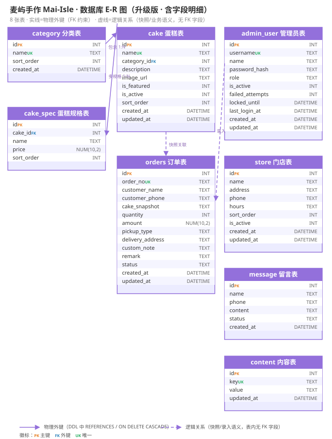
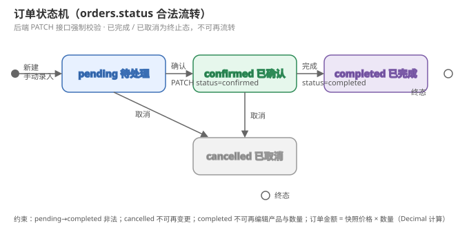

# 麦屿手作（Mai-Isle）数据库设计文档

## 1. 文档信息

| 项目   | 内容                                                       |
| ---- | -------------------------------------------------------- |
| 品牌名称 | 麦屿手作 Mai-Isle                                            |
| 文档名称 | 数据库设计文档（ER 图 / 数据字典 / 建表 SQL）                            |
| 版本   | v1.1                                                     |
| 创建日期 | 2026-08-27                                               |
| 文档状态 | 待评审                                                      |
| 数据库  | SQLite（轻量方案，数据库文件 `database/mai_isle.db`）                |
| 依据文档 | 蛋糕店官网PRD.md（v2.3）、麦屿手作技术开发文档.md（v1.1）、API接口契约文档.md（v1.0） |

### 1.1 文档定位

本文档是《麦屿手作》项目**数据库设计的详细展开与评审版**：以技术开发文档第 4 章（数据库设计）为源头，展开为可独立评审、可交付 DBA 与开发逐条对照执行的正式文档。**字段定义与建表 SQL 以技术开发文档为最终准绳（单一事实源）**，两处文档保持一致。覆盖三大交付物：

- **ER 图**：8 张表的实体关系总览（含字段明细、物理外键与逻辑关系区分）
- **数据字典**：8 张表逐字段定义（类型、约束、默认值、业务含义、对应 PRD 功能）
- **建表 SQL**：可直接在 SQLite 执行的完整 DDL（含索引、CHECK、级联）

### 1.2 变更记录

| 版本   | 日期         | 变更内容                                                |
| ---- | ---------- | --------------------------------------------------- |
| v1.0 | 2026-08-27 | 初始版本，基于 PRD v2.3、技术开发文档 v1.1（第 4 章）与 API 契约 v1.0 撰写 |
| v1.1 | 2026-08-27 | **架构师组长评审修订**：① 修正 1.1/1.3 文档定位矛盾（"唯一权威"与"技术文档为最终准绳"冲突）；② 修正 3.2 R4 与 8.1 交叉引用 8.3→8.2（悬空引用）；③ 蛋糕描述取消"Markdown"标注（非富文本）；④ 快照 price 类型由字符串改为数值（对齐技术文档 §5.3.5）；⑤ 补充订单号并发生成细节、DDL 设计要点两条说明（条件必填/金额正数性）；⑥ 8.2 二期预留补留言处理时间；⑦ 附录 B 新增差异裁定 #5（content key 9 vs 10 笔误）、#6（price 类型） |

### 1.3 差异裁定原则

当各文档出现冲突时，优先级为 **PRD v2.3 = UI/UX 文档 v1.2 > API 契约 v1.0 > 原型**（与技术开发文档 §0.3 一致）。**本文档与技术开发文档出现不一致时，以技术开发文档为最终准绳，并立即同步两处。** 本文档在附录 B 记录了差异裁定明细与已发现的历史笔误，供读者核对。

---

## 2. 设计原则与全局约定

### 2.1 设计原则（八条）

| #  | 原则                         | 说明                                                                 | 对应需求               |
| -- | -------------------------- | ------------------------------------------------------------------ | ------------------ |
| P1 | **8 张表覆盖全部业务**             | 管理员、分类、蛋糕、蛋糕规格、订单、门店、留言、内容                                         | PRD §6             |
| P2 | **规格独立成表**                 | 多规格价格是前台详情页、订单金额计算的依据，独立表便于维护与查询                                   | PRD §6.2.4 F3-1    |
| P3 | **订单保存快照**                 | `cake_snapshot` JSON 记录下单时产品名/规格名/单价，改产品配置不影响历史订单                  | PRD §6.3.4         |
| P4 | **内容表 key-value 结构**       | content 表以 `key` 区分 10 类运营内容，`value` 存 JSON 或 Markdown，前台按 key 读取  | PRD §6.3.6 F13     |
| P5 | **登录锁定持久化**                | admin_user 表内置 `failed_attempts` 与 `locked_until`，连续 5 次错误锁定 15 分钟 | PRD §6.3.1         |
| P6 | **金额一律 NUMERIC + Decimal** | 价格/金额用 `NUMERIC(10,2)` 存储，后端用 `Decimal` 计算，杜绝浮点误差                  | 技术开发文档 v1.1 §0.2-⑥ |
| P7 | **显式开启 SQLite 外键**         | SQLite 默认不启用外键约束，必须 `PRAGMA foreign_keys=ON`，否则 CASCADE 与外键校验静默失效  | 技术开发文档 v1.1 §7.4   |
| P8 | **快照关系不设物理外键**             | orders 与 cake、admin_user 之间为逻辑关系（快照/录入语义），不建 FK 字段，避免历史数据被级联影响     | 技术开发文档 v1.1 §4.1   |

### 2.2 全局类型约定

| SQLite 类型                           | 用途 | 说明                                                 |
| ----------------------------------- | -- | -------------------------------------------------- |
| `INTEGER PRIMARY KEY AUTOINCREMENT` | 主键 | 所有表统一自增主键 `id`                                     |
| `TEXT`                              | 文本 | 不设长度上限，由应用层校验（PRD 字段级规则）                           |
| `NUMERIC(10,2)`                     | 金额 | 价格（>0）与订单金额，配合 Decimal 计算                          |
| `DATETIME`                          | 时间 | 存 UTC 时间，展示层转本地时区；默认由后端 `datetime.utcnow` 写入       |
| `INTEGER`                           | 布尔 | 统一用 0/1 表示 false/true（`is_active`、`is_featured` 等） |

### 2.3 全局命名与维护约定

- **表名/字段名**：小写蛇形命名（snake_case），单数形式（`cake`、`store`，例外：`orders` 复数保留原设计）
- **时间字段**：`created_at`（创建）、`updated_at`（更新，仅数据可变更的表具备，见各表定义）
- **排序字段**：统一 `sort_order`，**数值越小越靠前**，默认 0
- **布尔字段**：`is_*` 前缀，1=是/启用/上架，0=否/停用/下架
- **状态字段**：`status` 一律 TEXT + CHECK 约束枚举，避免魔法数字
- **软删除**：本项目不采用软删除；商品不支持删除仅下架（`is_active=0`），门店/留言可物理删除
- **外键**：仅两处物理外键（见 3.2 关系说明），其余跨表关联一律逻辑关联
- **PRAGMA 约定**：任何 SQLite 连接建立后必须先执行 `PRAGMA foreign_keys=ON`（含 ORM 事件监听，见技术开发文档 §7.4）

---

## 3. 概念模型（ER 图）

### 3.1 实体关系图（升级版 · 含字段明细）



> 上图由绘图工具渲染生成，源文件 `images/db-er.svg`（可编辑，修改后需同步更新本文档第 4、5 章）。

**读图说明**：

- **实线** = 物理外键（DDL 中 REFERENCES / ON DELETE CASCADE 强制约束）
- **虚线** = 逻辑关系（快照/录入语义，表内无 FK 字段，由应用层保证一致性）
- **徽标**：`PK` 主键（橙）、`FK` 外键（蓝）、`UK` 唯一（绿）

### 3.2 实体关系说明表

| #  | 关系                          | 基数    | 类型       | 外键字段                                            | 说明                                                                     |
| -- | --------------------------- | ----- | -------- | ----------------------------------------------- | ---------------------------------------------------------------------- |
| R1 | category（分类）→ cake（蛋糕）      | 1 : N | **物理外键** | `cake.category_id → category.id`                | 一个分类下可有多个蛋糕；蛋糕下架但分类保留；删除分类前须先迁移产品（PRD F10-5）                           |
| R2 | cake（蛋糕）→ cake_spec（规格）     | 1 : N | **物理外键** | `cake_spec.cake_id → cake.id ON DELETE CASCADE` | 一个蛋糕至少 1 个规格；删除蛋糕时规格级联删除                                               |
| R3 | cake（蛋糕）→ orders（订单）        | 1 : N | 逻辑关系     | 无（`orders.cake_snapshot` JSON 含 `cake_id`）      | 订单通过快照记录下单时的产品信息，不建物理外键，保证产品配置变更不影响历史订单                                |
| R4 | admin_user（管理员）→ orders（订单） | 1 : N | 逻辑关系     | 无（业务语义"谁录入的"）                                   | 本期 orders 表未存录入人字段；如需追踪录入人，二期可在 orders 增加 `created_by` 字段（参见 8.2 预留说明） |
| R5 | store / message / content   | 独立实体  | -        | -                                               | 无跨表关联，各自独立维护                                                           |

> **为什么快照关系不建物理外键（P8）**：若 `orders.cake_id` 直接外键引用 `cake.id`，则产品被删除（虽然本期仅下架不删除）或分类调整时，历史订单会受影响；快照方案将"当时的成交事实"完整保存在订单行内，是最稳妥的电商订单设计（技术开发文档 §4.1 同源）。

---

## 4. 数据字典

> 说明：字段"允许 NULL"列中 `否` 表示 NOT NULL。`约束` 列标注 PK/UK/FK/CHECK 等。每张表末尾附索引清单与对应 PRD 功能。

### 4.1 管理员表 `admin_user`

**用途**：后台管理系统登录账号，含角色、启用状态与登录锁定信息。对应 PRD §6.3.1（F8 登录）、§6.3.8（F15 管理员管理）。

| 字段              | 类型       | 允许 NULL | 默认值   | 约束                              | 说明                                           |
| --------------- | -------- | ------- | ----- | ------------------------------- | -------------------------------------------- |
| id              | INTEGER  | 否       | 自增    | PK                              | 主键                                           |
| username        | TEXT     | 否       | -     | UNIQUE                          | 登录账号，全局唯一（PRD F15-5 规则约束）                    |
| name            | TEXT     | 否       | -     | -                               | 姓名                                           |
| password_hash   | TEXT     | 否       | -     | -                               | 密码哈希（bcrypt 4.0.x，见技术开发文档 §2.2），**明文密码绝不落库** |
| role            | TEXT     | 否       | 'ops' | CHECK (role IN ('super','ops')) | super=超级管理员 / ops=运营管理员（PRD §4.2）            |
| is_active       | INTEGER  | 否       | 1     | -                               | 1=启用 0=停用；停用账号无法登录（PRD F15-4）                |
| failed_attempts | INTEGER  | 否       | 0     | -                               | 连续密码错误次数，达 5 次锁定（PRD §6.3.1）                 |
| locked_until    | DATETIME | 是       | NULL  | -                               | 锁定截止时间；NULL=未锁定；到时自动解锁                       |
| last_login_at   | DATETIME | 是       | NULL  | -                               | 最后登录时间                                       |
| created_at      | DATETIME | 否       | -     | -                               | 创建时间                                         |
| updated_at      | DATETIME | 否       | -     | -                               | 更新时间                                         |

**索引清单**：`username` UNIQUE 隐式唯一索引；无额外索引（单表数据量小）。

**业务规则落地**：

- 连续 5 次密码错误 → `failed_attempts=5` 且 `locked_until = now + 15 分钟`（技术开发文档 §7.6）
- 登录成功时清零 `failed_attempts`、置空 `locked_until`、刷新 `last_login_at`
- 系统至少保留 1 个超级管理员，超管账号不可删除（PRD §6.3.8）

---

### 4.2 分类表 `category`

**用途**：蛋糕分类（8 个初始系列 + 后台可增删改）。对应 PRD §6.2.3（F2-1 左侧分类导航）、§6.3.3（F10-5 分类管理）。

| 字段         | 类型       | 允许 NULL | 默认值 | 约束     | 说明                   |
| ---------- | -------- | ------- | --- | ------ | -------------------- |
| id         | INTEGER  | 否       | 自增  | PK     | 主键                   |
| name       | TEXT     | 否       | -   | UNIQUE | 分类名（2–30 字），唯一       |
| sort_order | INTEGER  | 否       | 0   | -      | 排序，越小越靠前（前台分类导航按此升序） |
| created_at | DATETIME | 否       | -   | -      | 创建时间                 |

**索引清单**：`name` UNIQUE 隐式唯一索引。

**业务规则落地**：

- 删除分类时，该分类下产品需先迁移到其他分类（接口以 `move_to_id` **Query 参数**接收目标分类，见技术开发文档 §5.3.4；DELETE body 存在兼容性风险，禁止使用）
- 分类不可删除时（尚有未迁移产品），接口返回 409 冲突

---

### 4.3 蛋糕表 `cake`

**用途**：蛋糕产品主表，含分类归属、上下架、首页推荐、排序。对应 PRD §6.2.3（F2 蛋糕展示）、§6.2.4（F3 蛋糕详情）、§6.3.3（F10 商品管理）。

| 字段          | 类型       | 允许 NULL | 默认值  | 约束                   | 说明                                        |
| ----------- | -------- | ------- | ---- | -------------------- | ----------------------------------------- |
| id          | INTEGER  | 否       | 自增   | PK                   | 主键                                        |
| name        | TEXT     | 否       | -    | UNIQUE               | 产品名（2–50 字），唯一（PRD F10 字段级规则）             |
| category_id | INTEGER  | 否       | -    | **FK → category.id** | 所属分类                                      |
| description | TEXT     | 是       | NULL | -                    | 描述（≤2000 字，多行文本；非富文本，仅 content 表品牌文案为 Markdown）|
| image_url   | TEXT     | 否       | -    | -                    | 产品图 URL（≤5MB，jpg/png/webp；相对路径存 uploads/） |
| is_featured | INTEGER  | 否       | 0    | -                    | 1=首页推荐（精选蛋糕取 上架 + 推荐，PRD F1-2）            |
| is_active   | INTEGER  | 否       | 1    | -                    | 1=上架 0=下架；下架后前台不可见（PRD F10-4）             |
| sort_order  | INTEGER  | 否       | 0    | -                    | 排序，越小越靠前（前台列表升序，再按创建时间倒序）                 |
| created_at  | DATETIME | 否       | -    | -                    | 创建时间                                      |
| updated_at  | DATETIME | 否       | -    | -                    | 更新时间                                      |

**索引清单**：

| 索引名                  | 字段                      | 用途              |
| -------------------- | ----------------------- | --------------- |
| idx_cake_category    | category_id             | 分类筛选加速          |
| idx_cake_active_sort | (is_active, sort_order) | 前台"上架 + 排序"查询加速 |

**业务规则落地**：

- 产品**不支持删除**，仅允许下架（PRD §6.3.3 边界与异常）
- 产品下架后，详情页不可访问（返回 404 或跳转蛋糕展示页，PRD F3 规则约束）
- 前台列表仅展示 `is_active=1`，排序 `sort_order ASC, created_at DESC`
- 首页精选蛋糕：`is_active=1 AND is_featured=1`，按 `sort_order` 升序，最多 6 个

---

### 4.4 蛋糕规格表 `cake_spec`

**用途**：蛋糕的多规格价格（如 6 寸 ¥168 / 8 寸 ¥228）。对应 PRD §6.2.4（F3-1 规格与价格）、§6.3.3（F10-2 规格配置）。

| 字段         | 类型            | 允许 NULL | 默认值 | 约束                                 | 说明                |
| ---------- | ------------- | ------- | --- | ---------------------------------- | ----------------- |
| id         | INTEGER       | 否       | 自增  | PK                                 | 主键                |
| cake_id    | INTEGER       | 否       | -   | **FK → cake.id ON DELETE CASCADE** | 所属蛋糕；蛋糕删除时规格级联删除  |
| name       | TEXT          | 否       | -   | -                                  | 规格名（≤20 字，如"6 寸"） |
| price      | NUMERIC(10,2) | 否       | -   | CHECK (price > 0)                  | 规格价格（>0，最多两位小数）   |
| sort_order | INTEGER       | 否       | 0   | -                                  | 排序，越小越靠前          |

**索引清单**：`idx_spec_cake`（cake_id）。

**业务规则落地**：

- 每个蛋糕**至少 1 个规格**（PRD F10-2 字段级规则），后端在事务中校验并保存
- "起价" = 该蛋糕规格中最低价格（前台卡片展示"¥168 起"）
- 订单保存所选规格价格的**快照**，后续修改规格价格不影响历史订单

---

### 4.5 订单表 `orders`

**用途**：电话订单主表（后台手动录入），含客户信息、产品快照、金额、取货方式与状态流转。对应 PRD §6.3.4（F11 订单管理）。

| 字段               | 类型            | 允许 NULL | 默认值       | 约束                                                                | 说明                                                             |
| ---------------- | ------------- | ------- | --------- | ----------------------------------------------------------------- | -------------------------------------------------------------- |
| id               | INTEGER       | 否       | 自增        | PK                                                                | 主键                                                             |
| order_no         | TEXT          | 否       | -         | UNIQUE                                                            | 订单号，规则 `YYYYMMDD + 当日序号`（如 20260826001，技术开发文档 §7.8）            |
| customer_name    | TEXT          | 否       | -         | -                                                                 | 客户姓名（2–20 字）                                                   |
| customer_phone   | TEXT          | 否       | -         | -                                                                 | 联系电话（11 位手机号，格式校验）                                             |
| cake_snapshot    | TEXT          | 否       | -         | -                                                                 | **JSON 快照**，结构见 6.2 节：`{cake_id, cake_name, spec_name, price}` |
| quantity         | INTEGER       | 否       | -         | CHECK (quantity >= 1)                                             | 订购数量（≥1）                                                       |
| amount           | NUMERIC(10,2) | 否       | -         | -                                                                 | 订单金额 = 快照价格 × 数量，**自动计算、不可手改**（Decimal 计算）                     |
| pickup_type      | TEXT          | 否       | -         | CHECK (pickup_type IN ('self','delivery'))                        | self=到店自提 / delivery=配送                                        |
| delivery_address | TEXT          | 是       | NULL      | -                                                                 | 配送地址（≤200 字）；取货方式为 delivery 时**必填**（条件必填）                      |
| custom_note      | TEXT          | 是       | NULL      | -                                                                 | 定制需求（≤500 字，记录尺寸/口味/图案/祝福语）                                    |
| remark           | TEXT          | 是       | NULL      | -                                                                 | 备注（≤500 字）                                                     |
| status           | TEXT          | 否       | 'pending' | CHECK (status IN ('pending','confirmed','completed','cancelled')) | 订单状态，流转见 6.1 节状态机                                              |
| created_at       | DATETIME      | 否       | -         | -                                                                 | 创建时间                                                           |
| updated_at       | DATETIME      | 否       | -         | -                                                                 | 更新时间                                                           |

**索引清单**：

| 索引名                | 字段              | 用途              |
| ------------------ | --------------- | --------------- |
| idx_orders_status  | status          | 状态筛选（后台列表按状态过滤） |
| idx_orders_created | created_at DESC | 订单列表时间倒序、最近订单   |

**业务规则落地**：

- 订单金额由后端以所选规格价格 × 数量自动计算，**不可手改**（PRD §6.3.4）
- 订单号自动生成：`YYYYMMDD + 当日 3 位序号`（同日内查当日最大 order_no 后 +1，3 位补零，如 `20260827001`），当日序号跨天重置；并发处理见技术开发文档 §7.8
- 已完成订单不可再编辑产品与数量；已取消订单不可再变更状态
- 状态合法流转见 6.1 节（后端 PATCH 接口强制校验）

---

### 4.6 门店表 `store`

**用途**：门店信息（名称、地址、电话、营业时间、排序、展示开关）。对应 PRD §6.2.6（F5 门店信息）、§6.3.5（F12 门店管理）。

| 字段         | 类型       | 允许 NULL | 默认值  | 约束 | 说明                             |
| ---------- | -------- | ------- | ---- | -- | ------------------------------ |
| id         | INTEGER  | 否       | 自增   | PK | 主键                             |
| name       | TEXT     | 否       | -    | -  | 门店名（2–30 字）                    |
| address    | TEXT     | 否       | -    | -  | 地址（≤100 字）                     |
| phone      | TEXT     | 否       | -    | -  | 电话（≤20 字，电话格式校验）               |
| hours      | TEXT     | 是       | NULL | -  | 营业时间（≤50 字，如"08:00-21:00"）     |
| image_url  | TEXT     | 是       | NULL | -  | 门店图 URL（≤5MB，jpg/png/webp；相对路径存 uploads/stores/；无图时前台门店卡不展示图片） |
| sort_order | INTEGER  | 否       | 0    | -  | 排序，越小越靠前（前台按此升序展示）             |
| is_active  | INTEGER  | 否       | 1    | -  | 1=启用 0=停用；停用门店前台不展示（PRD F12-3） |
| created_at | DATETIME | 否       | -    | -  | 创建时间                           |
| updated_at | DATETIME | 否       | -    | -  | 更新时间                           |

**索引清单**：无额外索引（数据量小；前台查询按 `is_active, sort_order`，如需可加，本期不做）。`image_url` 仅存储展示，无需索引。

**业务规则落地**：

- 前台门店列表仅展示 `is_active=1`，按 `sort_order` 升序
- 首页门店概览取前 3 家（PRD F1-3）
- 门店支持物理删除（PRD F12-4），无级联依赖
- 门店图可选（允许为空）；上传校验与产品图一致（≤5MB，jpg/png/webp），目录 `uploads/stores/`（Q1 已确认，2026-08-27）

---

### 4.7 留言表 `message`

**用途**：前台"联系我们"留言表单提交的数据，后台集中管理。对应 PRD §6.2.7（F6-2 留言表单）、§6.3.7（F14 留言管理）。

| 字段         | 类型       | 允许 NULL | 默认值       | 约束                                   | 说明                              |
| ---------- | -------- | ------- | --------- | ------------------------------------ | ------------------------------- |
| id         | INTEGER  | 否       | 自增        | PK                                   | 主键                              |
| name       | TEXT     | 否       | -         | -                                    | 访客姓名（2–20 字）                    |
| phone      | TEXT     | 否       | -         | -                                    | 联系电话（11 位手机号，格式校验）              |
| content    | TEXT     | 否       | -         | -                                    | 留言内容（1–500 字）                   |
| status     | TEXT     | 否       | 'pending' | CHECK (status IN ('pending','done')) | pending=未处理 / done=已处理；新提交默认未处理 |
| created_at | DATETIME | 否       | -         | -                                    | 提交时间                            |

**索引清单**：`idx_message_status`（status）——仪表盘统计"未处理留言数"、留言列表状态筛选。

**业务规则落地**：

- 留言数据由前台表单产生，**后台不可新增**（PRD F14 规则约束）
- 新提交默认 `pending`（未处理）
- 后台可标记已处理/未处理、删除留言（PRD F14-3 / F14-4）
- 前台提交需通过图形验证码校验（防垃圾提交，PRD §9.2 风险清单）

---

### 4.8 内容表 `content`

**用途**：key-value 结构承载前台全部运营内容区块（Banner、品牌内容、订购信息等）。对应 PRD §6.3.6（F13 内容管理）。

| 字段         | 类型       | 允许 NULL | 默认值 | 约束     | 说明                     |
| ---------- | -------- | ------- | --- | ------ | ---------------------- |
| id         | INTEGER  | 否       | 自增  | PK     | 主键                     |
| key        | TEXT     | 否       | -   | UNIQUE | 内容键（取值见下方一览表，全局唯一）     |
| value      | TEXT     | 否       | -   | -      | 内容值：JSON 或 Markdown 文本 |
| updated_at | DATETIME | 否       | -   | -      | 更新时间（内容保存后前台实时生效）      |

**索引清单**：`key` UNIQUE 隐式唯一索引。

**content.key 取值一览**（10 个 key，与技术开发文档 §4.3 完全一致）：

| key             | 存储格式               | 对应前台区块                     | 备注                            |
| --------------- | ------------------ | -------------------------- | ----------------------------- |
| `banners`       | JSON 数组（**1–4 张**） | 首页 Hero 轮播                 | 数量上限以 PRD v2.3 为准（见附录 B 差异裁定） |
| `brand_story`   | Markdown           | 首页品牌故事 teaser + 关于麦屿品牌故事   | 富文本（加粗、段落、图片）                 |
| `brand_value`   | Markdown           | 关于麦屿品牌理念                   | 富文本                           |
| `brand_chars`   | JSON 数组            | 品牌特色卡片（甄选食材/手作工艺/服务初心）     | 每项含标题、描述、配图                   |
| `brand_journey` | JSON 数组            | 品牌历程时间线                    | 每项含年份、标题、描述                   |
| `hardware`      | JSON 数组            | 硬件保障列表                     | -                             |
| `software`      | JSON 数组            | 软件实力列表                     | -                             |
| `order_info`    | JSON 对象            | 订购专线/服务时间/配送说明（页脚+首页订购区共用） | 结构见 6.4 节                     |
| `contact_info`  | JSON 对象            | 联系我们页地址/邮箱                 | -                             |
| `custom_tips`   | Markdown           | 蛋糕详情页定制说明                  | 如"支持尺寸/口味/图案定制，提前 1 天预约"      |

**业务规则落地**：

- 内容区块为空时，对应前台区块整体隐藏（PRD §6.2.2：区块内容为空则隐藏，避免空白区域）
- `banners` 初始为空数组时首页 Hero 隐藏，符合验收标准（PRD §10.1）
- 品牌故事、品牌理念等长文案支持富文本编辑，存 Markdown，前端 react-markdown 渲染

---

## 5. 建表 SQL（SQLite 完整 DDL）

> 以下 DDL 可直接在 SQLite 执行，与技术开发文档 §4.3 **逐字段一致**（技术开发文档为最终准绳）。ORM 模型（models.py）字段与之一一对应。  
> **执行方式**：`python seed.py` 内部自动执行本脚本；首次运行亦可直接通过 sqlite3 CLI 或 `Base.metadata.create_all` 建表。  
> **重要**：连接建立后必须执行 `PRAGMA foreign_keys=ON`（SQLite 默认关闭外键，详见 2.1 P7）。

```sql
-- ============================================
-- 麦屿手作 Mai-Isle 数据库建表脚本
-- 数据库文件：database/mai_isle.db
-- 执行方式：python seed.py（内部自动执行本脚本）
-- ============================================

-- 1. 管理员表
CREATE TABLE admin_user (
    id              INTEGER PRIMARY KEY AUTOINCREMENT,
    username        TEXT    NOT NULL UNIQUE,             -- 登录账号，唯一
    name            TEXT    NOT NULL,                    -- 姓名
    password_hash   TEXT    NOT NULL,                    -- 密码哈希（bcrypt）
    role            TEXT    NOT NULL DEFAULT 'ops'
                    CHECK (role IN ('super', 'ops')),    -- super=超级管理员 / ops=运营管理员
    is_active       INTEGER NOT NULL DEFAULT 1,          -- 1=启用 0=停用
    failed_attempts INTEGER NOT NULL DEFAULT 0,          -- 连续密码错误次数
    locked_until    DATETIME,                            -- 锁定截止时间（NULL=未锁定）
    last_login_at   DATETIME,                            -- 最后登录时间
    created_at      DATETIME NOT NULL,
    updated_at      DATETIME NOT NULL
);

-- 2. 分类表
CREATE TABLE category (
    id          INTEGER PRIMARY KEY AUTOINCREMENT,
    name        TEXT    NOT NULL UNIQUE,                 -- 分类名（2-30 字）
    sort_order  INTEGER NOT NULL DEFAULT 0,              -- 排序，越小越靠前
    created_at  DATETIME NOT NULL
);

-- 3. 蛋糕表
CREATE TABLE cake (
    id           INTEGER PRIMARY KEY AUTOINCREMENT,
    name         TEXT    NOT NULL UNIQUE,                -- 产品名（2-50 字，唯一）
    category_id  INTEGER NOT NULL REFERENCES category(id),
    description  TEXT,                                   -- 描述（≤2000 字）
    image_url    TEXT    NOT NULL,                       -- 产品图 URL
    is_featured  INTEGER NOT NULL DEFAULT 0,             -- 1=首页推荐
    is_active    INTEGER NOT NULL DEFAULT 1,             -- 1=上架 0=下架
    sort_order   INTEGER NOT NULL DEFAULT 0,
    created_at   DATETIME NOT NULL,
    updated_at   DATETIME NOT NULL
);
CREATE INDEX idx_cake_category ON cake(category_id);
CREATE INDEX idx_cake_active_sort ON cake(is_active, sort_order);

-- 4. 蛋糕规格表（多规格价格）
CREATE TABLE cake_spec (
    id         INTEGER PRIMARY KEY AUTOINCREMENT,
    cake_id    INTEGER NOT NULL REFERENCES cake(id) ON DELETE CASCADE,
    name       TEXT    NOT NULL,                         -- 规格名（≤20 字，如"6 寸"）
    price      NUMERIC(10,2) NOT NULL CHECK (price > 0), -- 价格（>0，两位小数）
    sort_order INTEGER NOT NULL DEFAULT 0
);
CREATE INDEX idx_spec_cake ON cake_spec(cake_id);

-- 5. 订单表（电话订单，后台手动录入）
CREATE TABLE orders (
    id               INTEGER PRIMARY KEY AUTOINCREMENT,
    order_no         TEXT    NOT NULL UNIQUE,            -- 订单号 YYYYMMDD+序号
    customer_name    TEXT    NOT NULL,                   -- 客户姓名（2-20 字）
    customer_phone   TEXT    NOT NULL,                   -- 联系电话（11 位手机号）
    cake_snapshot    TEXT    NOT NULL,                   -- JSON 快照 {cake_id,cake_name,spec_name,price}
    quantity         INTEGER NOT NULL CHECK (quantity >= 1),
    amount           NUMERIC(10,2) NOT NULL,             -- 自动计算 = 快照价格 × 数量
    pickup_type      TEXT    NOT NULL
                     CHECK (pickup_type IN ('self', 'delivery')),  -- self=到店自提 delivery=配送
    delivery_address TEXT,                               -- 配送地址（配送时必填，≤200 字）
    custom_note      TEXT,                               -- 定制需求（≤500 字）
    remark           TEXT,                               -- 备注（≤500 字）
    status           TEXT    NOT NULL DEFAULT 'pending'
                     CHECK (status IN ('pending','confirmed','completed','cancelled')),
    created_at       DATETIME NOT NULL,
    updated_at       DATETIME NOT NULL
);
CREATE INDEX idx_orders_status ON orders(status);
CREATE INDEX idx_orders_created ON orders(created_at DESC);

-- 6. 门店表
CREATE TABLE store (
    id         INTEGER PRIMARY KEY AUTOINCREMENT,
    name       TEXT    NOT NULL,                         -- 门店名（2-30 字）
    address    TEXT    NOT NULL,                         -- 地址（≤100 字）
    phone      TEXT    NOT NULL,                         -- 电话（≤20 字）
    hours      TEXT,                                     -- 营业时间（≤50 字，如"08:00-21:00"）
    image_url  TEXT,                                     -- 门店图 URL（可选，≤5MB，jpg/png/webp）
    sort_order INTEGER NOT NULL DEFAULT 0,
    is_active  INTEGER NOT NULL DEFAULT 1,               -- 1=启用 0=停用
    created_at DATETIME NOT NULL,
    updated_at DATETIME NOT NULL
);

-- 7. 留言表（前台联系我们表单产生）
CREATE TABLE message (
    id         INTEGER PRIMARY KEY AUTOINCREMENT,
    name       TEXT    NOT NULL,                         -- 姓名（2-20 字）
    phone      TEXT    NOT NULL,                         -- 电话（11 位手机号）
    content    TEXT    NOT NULL,                         -- 留言内容（1-500 字）
    status     TEXT    NOT NULL DEFAULT 'pending'
               CHECK (status IN ('pending', 'done')),    -- pending=未处理 done=已处理
    created_at DATETIME NOT NULL
);
CREATE INDEX idx_message_status ON message(status);

-- 8. 内容表（key-value，前台内容区块）
CREATE TABLE content (
    id         INTEGER PRIMARY KEY AUTOINCREMENT,
    key        TEXT    NOT NULL UNIQUE,                  -- 内容键（见 4.8 一览表）
    value      TEXT    NOT NULL,                         -- JSON 或 Markdown 文本
    updated_at DATETIME NOT NULL
);

-- ============================================
-- 建表后初始化数据见第 7 章种子数据（seed.py）
-- ============================================
```

### 5.1 DDL 设计要点注释

| 设计点      | 位置                                                    | 说明                                     |
| -------- | ----------------------------------------------------- | -------------------------------------- |
| 外键声明     | cake.category_id、cake_spec.cake_id                    | SQLite 支持内联 REFERENCES 语法；配合 PRAGMA 生效 |
| 级联删除     | cake_spec.cake_id ON DELETE CASCADE                   | 仅规格随蛋糕删除级联；orders 不级联（快照设计）            |
| CHECK 约束 | role、pickup_type、status、message.status、price、quantity | 枚举/范围在数据库层兜底，应用层仍做校验（双保险）              |
| 组合索引     | idx_cake_active_sort                                  | 匹配前台"上架状态 + 排序"查询模式                    |
| 降序索引     | idx_orders_created                                    | SQLite 3.3+ 支持 DESC 索引，匹配列表倒序          |
| 跨字段条件必填 | orders.delivery_address                               | "取货方式为配送时地址必填"由**应用层校验**（技术开发文档 §5.3.5 处理流程第 1 步）；数据库层不设跨列 CHECK，保持与技术文档 DDL 一致 |
| 金额正数性    | orders.amount                                         | 无 `CHECK(amount>0)`：由 `price>0 × quantity≥1` 数学保证恒正，无需重复约束 |

---

## 6. 业务规则在库表的落地

### 6.1 订单状态机

订单状态流转约束在**后端 PATCH 接口强制校验**（技术开发文档 §5.3.5），前端按状态渲染可操作按钮。数据库层以 CHECK 约束保证枚举合法，业务层保证流转合法。



**合法流转表**（后端校验依据）：

| 当前状态           | 允许流转到                 | 禁止        |
| -------------- | --------------------- | --------- |
| pending（待处理）   | confirmed / cancelled | completed |
| confirmed（已确认） | completed / cancelled | pending   |
| completed（已完成） | 无                     | 任何流转（终止态） |
| cancelled（已取消） | 无                     | 任何流转（终止态） |

**附加规则**：已完成订单不可再编辑产品与数量；已取消订单不可再变更状态（PRD §6.3.4 边界与异常）。

### 6.2 订单快照 `cake_snapshot` 结构

订单保存下单时产品与规格的价格快照，后续修改产品规格配置不影响历史订单（PRD §6.3.4）。JSON 结构约定：

```json
{
  "cake_id": 12,
  "cake_name": "红丝绒芝士蛋糕",
  "spec_name": "8 寸",
  "price": 228.00
}
```

> `price` 以**两位小数数值**存储（与技术开发文档 §5.3.5 新增订单处理流程的快照示例 `{"price":198.00}` 一致）；金额计算统一用 Decimal（`amount = Decimal(price) × quantity`，见技术开发文档 §7.8），读取出 JSON 后转 Decimal 参与运算，避免 float 参与乘除。

### 6.3 登录锁定字段语义

| 场景         | 字段操作                                                              |
| ---------- | ----------------------------------------------------------------- |
| 密码错误 1–4 次 | `failed_attempts + 1`                                             |
| 密码错误第 5 次  | `failed_attempts = 5`，`locked_until = now + 15 分钟`                |
| 锁定期间登录     | 接口拒绝并提示"账号已锁定，请稍后再试"（提前返回，不消耗计数）                                  |
| 锁定到期后登录    | `locked_until` 已过 → 清零计数、正常校验                                     |
| 登录成功       | `failed_attempts = 0`、`locked_until = NULL`、`last_login_at = now` |

### 6.4 常用内容 key 的 JSON 结构

```jsonc
// order_info（订购信息，页脚 + 首页订购区共用）
{
  "hotline": "021-XXXXXXX",
  "hours": "08:00-18:00",
  "delivery_note": "11 点前订购当日送达 · 市内免费配送"
}

// contact_info（联系我们）
{
  "address": "上海市浦东新区迎春路 767 号",
  "email": "hello@mai-isle.com"
}

// brand_chars（品牌特色卡片，数组）
[
  { "title": "甄选食材", "description": "…", "image_url": "/uploads/…" },
  { "title": "手作工艺", "description": "…", "image_url": "/uploads/…" },
  { "title": "服务初心", "description": "…", "image_url": "/uploads/…" }
]
```

### 6.5 分类删除与产品迁移

- 删除分类接口：`DELETE /api/v1/admin/categories/{id}?move_to_id={目标分类ID}`（目标分类作为 **Query 参数**，不用 DELETE body，规避中间层丢弃 body 的兼容性风险）
- 数据库操作在同一事务内完成：先 `UPDATE cake SET category_id=move_to_id WHERE category_id=被删分类`，再删除分类记录
- 若 `move_to_id` 缺失或目标分类不存在 → 409

---

## 7. 种子数据规划（seed.py）

> 初始化脚本 `server/seed.py` **幂等执行**（已存在的数据跳过，不重复插入），与技术开发文档 §4.4 完全一致。

### 7.1 初始分类（8 个系列）

| sort_order | 分类名   | 对应 PRD          |
| ---------- | ----- | --------------- |
| 1          | 红丝绒系列 | PRD §6.2.3 F2-1 |
| 2          | 慕斯系列  | 同上              |
| 3          | 芝士系列  | 同上              |
| 4          | 抹茶系列  | 同上              |
| 5          | 巧克力系列 | 同上              |
| 6          | 水果系列  | 同上              |
| 7          | 翻糖系列  | 同上              |
| 8          | 节日限定  | 同上              |

### 7.2 默认超级管理员

| 字段        | 值          | 说明                       |
| --------- | ---------- | ------------------------ |
| username  | `admin`    | 首登后建议在"管理员管理"中修改         |
| name      | `系统管理员`    | -                        |
| password  | `admin123` | 初始密码，**生产环境部署后必须修改**     |
| role      | `super`    | 系统至少保留 1 个超管（PRD §6.3.8） |
| is_active | `1`        | 启用                       |

```python
# seed.py 核心片段（示意）
from passlib.context import CryptContext
pwd = CryptContext(schemes=["bcrypt"], deprecated="auto")
admin = AdminUser(
    username="admin", name="系统管理员",
    password_hash=pwd.hash("admin123"),
    role="super", is_active=1,
)
```

### 7.3 内容初始化

> 文案来源：PRD §6.2.5.1 内容初始化参考。上线前运营可在后台自由编辑修改。

| key                                                     | 初始化值                                                                                          | 说明                   |
| ------------------------------------------------------- | --------------------------------------------------------------------------------------------- | -------------------- |
| `brand_story`                                           | 品牌故事 3 段文案："城市的节奏总是匆匆……2020 年，麦屿手作正式诞生。取名'麦屿'……"                                              | 见 PRD §6.2.5.1       |
| `brand_journey`                                         | 5 条时间线：2020 诞生 / 2021 中央手作工坊 / 2022 甄选食材体系 / 2024 门店 8 家 / 2026 数字化运营                         | 见 PRD §6.2.5.1 品牌历程表 |
| `order_info`                                            | `{"hotline": "021-XXXXXXX", "hours": "08:00-18:00", "delivery_note": "11 点前订购当日送达 · 市内免费配送"}` | 页脚 + 首页订购区共用         |
| `contact_info`                                          | `{"address": "上海市浦东新区迎春路 767 号", "email": "hello@mai-isle.com"}`                              | 联系我们页                |
| `custom_tips`                                           | `支持尺寸/口味/图案/祝福语定制，建议提前 1 天电话预约`                                                               | 蛋糕详情页定制说明            |
| `banners`                                               | `[]`（空数组）                                                                                     | 上线前由运营在后台补充图片        |
| `brand_value` / `brand_chars` / `hardware` / `software` | `[]` 或空串                                                                                      | 后台编辑后生效              |

> **注意**：`banners` 初始为空数组时，前台首页 Hero 区块整体隐藏（PRD §6.2.2 规则：区块内容为空则隐藏），符合验收要求（PRD §10.1）。

### 7.4 种子数据 SQL 参考（等价实现）

```sql
-- 分类（等价 SQL，seed.py 以 ORM 实现）
INSERT INTO category (name, sort_order, created_at) VALUES
('红丝绒系列', 1, datetime('now')),
('慕斯系列',   2, datetime('now')),
('芝士系列',   3, datetime('now')),
('抹茶系列',   4, datetime('now')),
('巧克力系列', 5, datetime('now')),
('水果系列',   6, datetime('now')),
('翻糖系列',   7, datetime('now')),
('节日限定',   8, datetime('now'));

-- 管理员密码必须经 bcrypt 哈希，禁止明文插入：
-- INSERT INTO admin_user (username, name, password_hash, role, created_at, updated_at)
-- VALUES ('admin', '系统管理员', '<bcrypt_hash>', 'super', datetime('now'), datetime('now'));
```

---

## 8. 表结构变更管理

本项目**未引入 Alembic 迁移工具**（技术开发文档 §4.3 同源说明）。改表结构时须遵守：

1. **三处同步更新**：`麦屿手作技术开发文档.md` §4.3 DDL、`models.py` ORM 模型、本文档（数据字典 + 建表 SQL），三处保持一致
2. **开发环境**：通过 `Base.metadata.create_all` 重建（会新建缺失表，不会改已有表结构），或手工 ALTER
3. **上线后改动**：需**先备份** `database/mai_isle.db` 与 `uploads/` 目录，再执行迁移 SQL
4. 涉及外键/约束变更时，先确认历史数据满足新约束，再执行 DDL

### 8.1 常见变更场景指引

| 场景          | 操作示例                                                               |
| ----------- | ------------------------------------------------------------------ |
| 新增字段        | `ALTER TABLE orders ADD COLUMN created_by INTEGER;`（预留录入人追踪，见 8.2） |
| 修改 CHECK 枚举 | 需重建表（SQLite 不支持改约束），导出数据 → 重建 → 导入                                 |
| 新增索引        | `CREATE INDEX ...`（无需重建表）                                          |
| 新增表         | 追加 DDL + 同步本文档 4/5 章                                               |

### 8.2 二期预留（不属本期范围）

- **录入人追踪**：orders 增加 `created_by INTEGER`（逻辑关联 admin_user.id），实现"订单由谁录入"审计
- **留言处理时间**：message 表本期无 `updated_at`/处理时间字段，仅以 status 标记已处理；若需"处理时长"运营分析，二期可加 `handled_at DATETIME`（标记 done 时写入）
- **多语言**：CN/EN 语言切换本期仅样式占位（PRD F1-7），二期若实现多语言内容，content 表需扩展 `lang` 维度或增加语言后缀 key
- **前台数据统计**：二期 PV/UV 与产品浏览量统计（PRD §7.2 埋点说明），需新增独立统计表

---

## 附录 A：索引总览

| 表          | 索引名                  | 字段                      | 类型     | 用途      |
| ---------- | -------------------- | ----------------------- | ------ | ------- |
| admin_user | (隐式)                 | username                | UNIQUE | 登录账号唯一  |
| category   | (隐式)                 | name                    | UNIQUE | 分类名唯一   |
| cake       | idx_cake_category    | category_id             | 普通     | 分类筛选    |
| cake       | idx_cake_active_sort | (is_active, sort_order) | 组合     | 前台上架+排序 |
| cake       | (隐式)                 | name                    | UNIQUE | 产品名唯一   |
| cake_spec  | idx_spec_cake        | cake_id                 | 普通     | 规格按蛋糕查询 |
| orders     | idx_orders_status    | status                  | 普通     | 状态筛选    |
| orders     | idx_orders_created   | created_at DESC         | 降序     | 时间倒序列表  |
| orders     | (隐式)                 | order_no                | UNIQUE | 订单号唯一   |
| message    | idx_message_status   | status                  | 普通     | 状态筛选/统计 |
| content    | (隐式)                 | key                     | UNIQUE | 内容键唯一   |

---

## 附录 B：差异裁定记录

| # | 涉及内容      | 文档冲突描述                                                                                   | 裁定结果                                | 依据                                                 |
| - | --------- | ---------------------------------------------------------------------------------------- | ----------------------------------- | -------------------------------------------------- |
| 1 | Hero 轮播数量 | 技术开发文档 v1.0 曾写 1–3 张；PRD v2.3 §6.2.2 F1-1 与变更记录明确 **1–4 张**；PRD §6.3.6 F13-1 文本残留"1–3 张" | **1–4 张**（content.banners 数组长度 1–4） | PRD v2.3 变更记录 + §6.2.2；技术开发文档 v1.1 §4.3 已同步为 1–4 张 |
| 2 | 表数量       | 技术开发文档 §4.1"8 张表"                                                                        | 8 张表，无异议                            | 技术开发文档 §4.1 / 本文档 §2.1                             |
| 3 | 订单金额      | 契约文档未细化计算规则                                                                              | 快照价格 × 数量，Decimal 计算，不可手改           | 技术开发文档 §0.2-⑥ / §7.8                               |
| 4 | 分类删除传参    | DELETE body 存在中间层兼容性风险                                                                   | `move_to_id` 走 **Query 参数**         | 技术开发文档 v1.1 §0.2-④                                 |
| 5 | content key 数量 | 技术开发文档 §4.1 设计原则写"9 类运营内容"，但 §4.3 一览表实际列出 **10 个 key**（banners/brand_story/brand_value/brand_chars/brand_journey/hardware/software/order_info/contact_info/custom_tips） | **10 个 key**（§4.1 的"9 类"为历史笔误，以 §4.3 一览表与本文档 §4.8 为准） | 技术开发文档 §4.3 / 本文档 §4.8                             |
| 6 | 快照 price 类型 | 本文档 v1.0 曾写字符串 `"228.00"`，技术开发文档 §5.3.5 示例为数字 `198.00`                                     | **两位小数数值**（跟随技术开发文档，Decimal 参与计算） | 技术开发文档 §5.3.5 / 本文档 §6.2                          |


---

*本文档由 小绿（WorkBuddy）根据 PRD v2.3 与技术开发文档 v1.1 撰写，供麦屿手作项目评审使用。*
